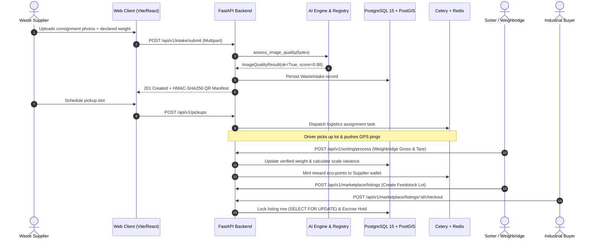
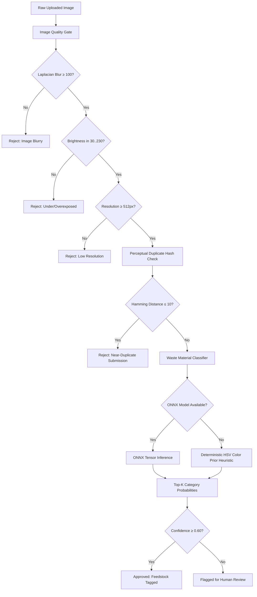
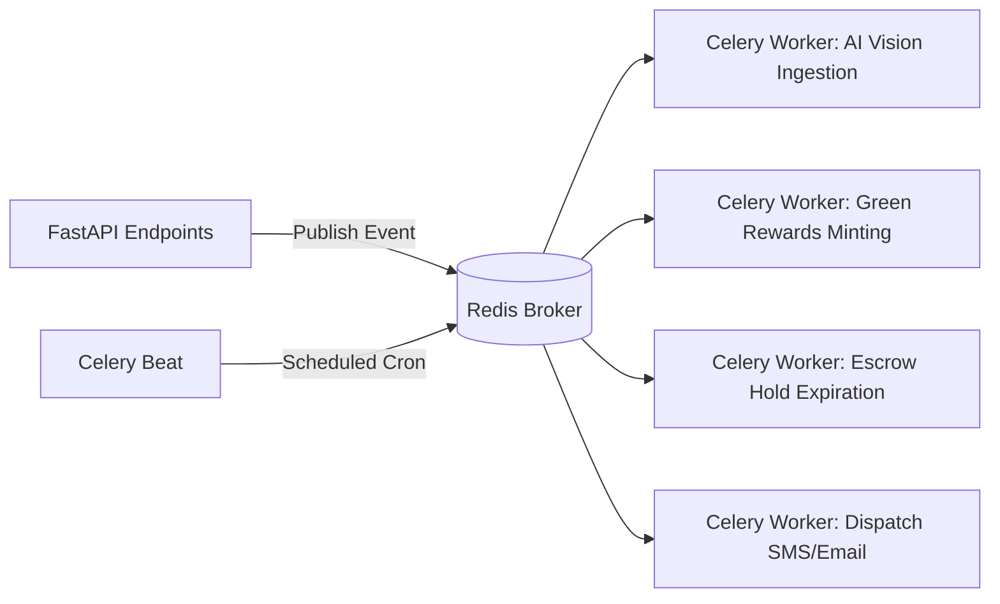

# ♻️ Circular Waste & Resource Marketplace

> **Production-grade AI-powered marketplace transforming municipal and industrial waste into certified circular feedstock.**

[](https://github.com)
[](https://pytest.org)
[](https://python.org)
[](https://nodejs.org)
[](LICENSE)

---

## 🌟 Elevator Pitch & Problem Framing

Municipalities and industrial zones generate billions of tonnes of unsegregated waste annually, causing catastrophic environmental degradation, landfill fires, and massive GHG emissions. Concurrently, manufacturing and recycling industries face acute deficits in dependable, uncontaminated secondary raw materials due to opaque pricing, fraudulent claims, and nonexistent traceability.

**Circular Waste Marketplace (CWM)** bridges this gap by creating an end-to-end, auditable circular value chain:
- **Suppliers** (households, food businesses, factories) submit segregated waste with AI quality gating and instant pricing estimates.
- **Logistics Operators** pick up consignments tracked via cryptographic QR manifests and live GPS telemetry.
- **Sorters & Aggregators** verify weighbridge receipts, assay moisture/contamination, and certify inventory lots.
- **Industrial Buyers** purchase verified feedstock through escrow-backed agreements or bid on dynamic material lots.
- **Green Loyalty Engine** mints eco-points, tracks recycling streaks, and quantifies verified carbon offsets ($tCO_2e$).

---

## 📸 Live System Preview

```text
┌────────────────────────────────────────────────────────────────────────────────────────┐
│                        CIRCULAR WASTE & RESOURCE MARKETPLACE                           │
├──────────────────────────────────────┬─────────────────────────────────────────────────┤
│ [AI Image Quality Gate]              │ [Dynamic Pricing Engine]                        │
│ • Laplacian Blur Variance: 342.5 (OK)│ • Base Benchmark Rate: ₹18.00/kg (PET)          │
│ • Brightness Uniformity: 138.2 (OK)  │ • Moisture Deductions: -0.0%                    │
│ • Deduplication pHash: 0x8a92... (OK)│ • Effective Unit Price: ₹18.00/kg               │
├──────────────────────────────────────┼─────────────────────────────────────────────────┤
│ [Cryptographic QR Manifest]          │ [Live Fleet Telemetry Stream]                   │
│ • Batch Hash: HMAC-SHA256            │ • Fleet Unit: MH-04-AZ-2918 (EV Van)            │
│ • Custody Nonce: #CWM-LOT-882194     │ • Speed: 38 km/h | Battery: 82% | Heading: 042° │
└──────────────────────────────────────┴─────────────────────────────────────────────────┘
```

---

## 📋 Role-Based Feature Matrix

| Capability / Workflow | Supplier / Generator | Sorter / Aggregator | Industrial Buyer | Platform Admin |
| :--- | :---: | :---: | :---: | :---: |
| **Consignment Submission** | ✅ Photo Upload + AI Gate | ❌ | ❌ | ✅ Override |
| **Dynamic Price Estimator** | ✅ Real-time Quote | ✅ Calibrate Benchmark | ✅ View Spot Rate | ✅ Manage Curves |
| **Biogas & Energy Estimation** | ✅ BMP Methane Yield | ✅ Facility Intake | ❌ | ✅ Audit Coefficients |
| **Pickup Scheduling** | ✅ Select Slot Window | ❌ | ❌ | ✅ Dispatch Fleet |
| **Live Telemetry & GPS Trail** | ✅ View My Pickup | ✅ Inbound Gate Alert | ❌ | ✅ Global Fleet Radar |
| **Weighbridge & Tare Assay** | ❌ | ✅ Gross/Tare Verification | ❌ | ✅ Audit Adjustments |
| **Feedstock Marketplace** | ❌ | ✅ List Certified Lots | ✅ Hold & Purchase | ✅ Moderate Catalog |
| **Escrow & Settlement** | ✅ Auto-payout Ledger | ✅ Settle Custody | ✅ Escrow Deposit | ✅ Dispute Arbitration |
| **Eco-Store Upcycled Goods** | ✅ Redeem Points | ✅ Redeem Points | ✅ Bulk Ordering | ✅ Inventory Sync |
| **ESG & Carbon Reporting** | ✅ Personal Avoided CO₂e | ✅ Yard Throughput | ✅ Scope 3 Reduction | ✅ Platform Auditing |

---

## 📐 Architecture Diagrams

### 1. End-to-End System Request Flow



### 2. AI Quality Gating & Classification Pipeline



### 3. Asynchronous Task & Event Pipeline



---

## 🛠️ Technology Stack & Selection Rationale

| Layer | Component | Choice | Rationale |
| :--- | :--- | :--- | :--- |
| **Backend Framework** | Web Core | **FastAPI 0.115+** | Native async concurrency, automatic OpenAPI schemas, high throughput ASGI performance. |
| **Database** | Relational / Geospatial | **PostgreSQL 15 + PostGIS** | ACID reliability, spatial distance calculations (`ST_DWithin`) for fleet routing, JSONB indexing. |
| **ORM** | Persistence Layer | **SQLAlchemy 2.0 (Async)** | Strictly typed async database queries with explicit eager loading (`selectinload`) preventing N+1 issues. |
| **Migrations** | Schema Evolution | **Alembic 1.14+** | Declarative autogeneration with full rollback capabilities and sync migration support. |
| **Cache & Pub/Sub** | Real-time Telemetry | **Redis 7.2+** | Sub-millisecond latency for vehicle GPS streams, transient lock management, Celery broker. |
| **Background Tasks** | Distributed Jobs | **Celery 5.4+** | Battle-tested retry logic, rate limiting, and scheduled cron jobs (`celery-beat`). |
| **AI / ML Engine** | Computer Vision | **ONNX Runtime + NumPy + Scipy** | Lightweight CPU-optimized model inference with deterministic fallbacks when models are absent. |
| **Frontend App** | UI Framework | **React 18 + Vite** | Instant HMR, component tree virtualization, modern JSX runtime. |
| **State Management** | Global Client State | **Zustand 5** | Minimal footprint, un-opinionated store hooks, zero boilerplate. |
| **Styling** | Design System | **TailwindCSS 3.4** | Utility-first responsive design, dark slate aesthetics, and glassmorphic card primitives. |
| **Charts** | Data Visualization | **Recharts 2.13** | Declarative SVG charting for landfill diversion trends and carbon offset accounting. |

---

## 📂 Repository Layout

```text
circular-waste-marketplace/
├── .env.example                  # Complete environment variable specification
├── .gitignore                    # Version control ignore rules
├── docker-compose.yml            # Multi-container orchestration (DB, Redis, Backend, Frontend)
├── README.md                     # Comprehensive technical documentation
├── database/
│   ├── init.sql                  # PostgreSQL extensions (PostGIS, UUID, Trigram)
│   └── seed.py                   # Reference data seeder (Categories, Pricing, Demo Users)
├── backend/
│   ├── Dockerfile                # Production multi-stage slim Python container
│   ├── alembic.ini               # Database migration configuration
│   ├── requirements.txt          # Production pinned dependencies
│   ├── requirements-dev.txt      # Testing and development tooling
│   ├── alembic/
│   │   ├── env.py                # Async Alembic environment runner
│   │   └── versions/             # Migration version scripts
│   ├── ai_engine/
│   │   ├── image_quality.py      # Laplacian blur, brightness, duplicate gating
│   │   ├── waste_classifier.py   # ONNX inference + HSV heuristic fallback
│   │   ├── pricing_engine.py     # Dynamic price formula calculator
│   │   ├── biogas_estimator.py   # Biochemical Methane Potential (BMP) model
│   │   └── model_registry.py     # Lazy singleton model session loader
│   └── app/
│       ├── main.py               # FastAPI application lifecycle & middleware
│       ├── core/                 # Settings, security, JWT RBAC, structured logging
│       ├── db/                   # Database engine, session maker, Declarative Base
│       ├── models/               # SQLAlchemy 2.0 ORM models
│       ├── schemas/              # Pydantic v2 request/response schemas
│       ├── routers/              # 12 versioned API routers (/api/v1/...)
│       ├── services/             # Business logic orchestration layer
│       ├── workers/              # Celery task definitions and schedules
│       └── tests/                # Pytest unit & integration test suites
└── frontend/
    ├── Dockerfile                # Multi-stage Vite build + Nginx static server
    ├── nginx.conf                # Production SPA reverse proxy with gzip
    ├── package.json              # Node dependencies and scripts
    ├── tsconfig.json             # TypeScript compiler settings
    ├── vite.config.ts            # Vite build and proxy configuration
    ├── tailwind.config.js        # Theme tokens and color palette
    └── src/
        ├── index.css             # Tailwind directives & glassmorphic classes
        ├── i18n.ts               # English & Hindi translation packs
        ├── main.jsx              # React 18 DOM mount point
        ├── api/                  # Axios HTTP client and type definitions
        ├── components/           # Navbar, Sidebar, StatCards, Badges, Buttons
        ├── layouts/              # Main responsive workspace shell
        ├── pages/                # Public landing page (HomePage)
        └── features/             # Vertical domain slices:
            ├── auth/             # Login, register, demo persona store
            ├── suppliers/        # Consignment submission with AI gating
            ├── pickups/          # Fleet booking & time slot scheduler
            ├── tracking/         # Live vector map & vehicle telemetry
            ├── sorting/          # Weighbridge intake & contamination assay
            ├── marketplace/      # Feedstock lot feed & escrow checkout
            ├── products/         # Upcycled circular eco-store
            ├── rewards/          # Eco-points wallet & streak tracker
            └── analytics/        # Landfill diversion & carbon offset charts
```

---

## ⚡ Quick Start (Docker)

### 📋 Prerequisites
- **Docker**: Docker Desktop 24.0+ with WSL2 backend enabled on Windows 10/11, or Docker Engine 24.0+ with Docker Compose v2 on Linux/macOS.
- **Hardware**: Minimum 4GB RAM allocated to Docker.
- **Ports Available on Host**: `5173` (Frontend), `8000` (FastAPI Backend), `5432` (PostgreSQL).

### 🚀 One-Command Launch Sequence
Go from zero to a fully running, healthy stack in under two minutes:

```bash
# 1. Clone repository & enter project directory
cd circular-waste-marketplace

# 2. Copy the environment configuration template
# On Linux / macOS / Git Bash:
cp .env.example .env

# On Windows PowerShell:
Copy-Item .env.example .env

# 3. Boot all services in detached mode
docker compose up --build -d
```

### 🌐 Service URLs
| Service | URL | Status / Verification |
| :--- | :--- | :--- |
| **Frontend Web Client** | [http://localhost:5173](http://localhost:5173) | Vite + React HMR dev server |
| **Backend Interactive Docs** | [http://localhost:8000/docs](http://localhost:8000/docs) | Swagger UI / OpenAPI 3.1 schema |
| **Backend Health Check** | [http://localhost:8000/health](http://localhost:8000/health) | Structured JSON (`{"status":"ok", ...}`) |
| **Backend Alternative Docs** | [http://localhost:8000/redoc](http://localhost:8000/redoc) | ReDoc API specification |

---

## 🛠️ Common Operations & Developer Ergonomics

### View Live Logs
```bash
# Stream all services
docker compose logs -f

# Stream individual service
docker compose logs -f api
docker compose logs -f postgres
docker compose logs -f frontend
```

### Shell Into Running Containers
```bash
# Backend container shell
docker compose exec api bash

# PostgreSQL interactive database shell
docker compose exec postgres psql -U cwm -d cwm

# Frontend container shell
docker compose exec frontend sh
```

### Reset Database & Clean Volumes
```bash
# Stop containers and remove named volumes (wipes PostgreSQL data cleanly)
docker compose down -v
```

### Rebuild After Dependency Updates
```bash
# Rebuild and start after modifying requirements.txt or package.json
docker compose up --build -d
```

---

## 🔍 Troubleshooting Guide

1. **Port Already in Use (`bind: address already in use: 5432 / 8000 / 5173`)**:
   - If a local PostgreSQL instance is running on port 5432, either stop the local service (`Stop-Service postgresql*` on Windows) or change `POSTGRES_HOST_PORT=5433` in `.env`.
   - If port 8000 is occupied, set `APP_PORT=8080` in `.env`.

2. **Docker Desktop / WSL2 Daemon Not Running**:
   - Verify Docker status using `docker info`. Ensure Docker Desktop is launched and WSL2 integration is enabled in *Settings > Resources > WSL Integration*.

3. **Vite Hot Module Reload (HMR) Not Triggering on Windows**:
   - Docker bind mounts across Windows/WSL2 host boundaries do not always propagate inotify filesystem events.
   - Vite is pre-configured with `usePolling: true` (1000ms interval) in `vite.config.ts` to ensure consistent live-reloading.

4. **Backend Startup Delay**:
   - The backend service declares `depends_on: postgres: condition: service_healthy`. It will wait for PostgreSQL's `pg_isready` check to succeed before initiating Uvicorn, avoiding startup flapping.

---

## 🔒 Secrets & .env Discipline

- **Template**: `.env.example` is committed to version control and contains all configuration keys with safe development defaults.
- **Local Secret Isolation**: `.env` is created locally and is strictly ignored by `.gitignore`. It must **never** be committed.
- **Production Operations**: In production/cloud environments (AWS ECS, GCP Cloud Run, Kubernetes), environment variables are injected via a secure secrets manager (AWS Secrets Manager, HashiCorp Vault, GCP Secret Manager).
- **Log Sanitation**: The backend and database startup scripts redact sensitive connection credentials and passwords from container stdout.

---

### Option 2: Local Manual Setup

#### Step 1: Backend Setup

```bash
cd backend

# Create virtual environment
python -m venv .venv

# Activate on Linux/macOS:
# source .venv/bin/activate
# Activate on Windows PowerShell:
.venv\Scripts\Activate.ps1

# Install dependencies
pip install -r requirements.txt -r requirements-dev.txt

# Run migrations
alembic upgrade head

# Seed initial categories and demo accounts
python ../database/seed.py

# Launch FastAPI development server
uvicorn app.main:app --host 0.0.0.0 --port 8000 --reload
```

#### Step 2: Frontend Setup

```bash
cd frontend

# Install Node dependencies
npm install

# Start Vite dev server
npm run dev
```

---

## 🔑 Environment Variables Specification

All configuration is managed through 12-factor environment variables with typed validation in `app/core/settings.py`:

| Variable | Default Value | Description |
| :--- | :--- | :--- |
| `APP_NAME` | `Circular Waste Marketplace` | Application name displayed in headers and logs. |
| `APP_ENV` | `development` | Environment mode (`development`, `staging`, `production`). |
| `APP_DEBUG` | `true` | Enables verbose SQL logging and stack traces. |
| `API_V1_PREFIX` | `/api/v1` | URL prefix for versioned REST routes. |
| `SECRET_KEY` | *(64-char hex)* | Cryptographic key for signing JWT bearer tokens. |
| `HMAC_SECRET_KEY` | *(64-char hex)* | Key for generating tamper-evident QR manifests. |
| `DATABASE_URL` | `postgresql+asyncpg://...` | Asynchronous connection string for application queries. |
| `DATABASE_URL_SYNC` | `postgresql://...` | Synchronous connection string for Alembic migrations. |
| `REDIS_URL` | `redis://redis:6379/0` | Cache, rate limiter, and GPS telemetry channel. |
| `CELERY_BROKER_URL` | `redis://redis:6379/1` | Background task queue message broker. |
| `STORAGE_BACKEND` | `local` | Upload storage provider (`local`, `s3`, `minio`). |
| `PAYMENT_PROVIDER` | `mock` | Payment processing gateway (`stripe`, `razorpay`, `mock`). |
| `FALLBACK_TO_HEURISTICS`| `true` | Allows deterministic heuristic inference when ONNX absent. |
| `PROMETHEUS_ENABLED` | `true` | Enables `/metrics` endpoint for Prometheus scraping. |

---

## 🤖 AI Engine Deep-Dive

The AI subsystem lives in `backend/ai_engine/` and provides modular, auditable material assessment services.

### 1. Image Quality Gate (`image_quality.py`)
Protects sorters and neural classifiers from garbage submissions:
- **Sharpness**: Laplacian variance $\sigma^2(\nabla^2 I)$. Blurry images ($\sigma^2 < 100$) are rejected.
- **Brightness**: Grayscale channel mean $\mu \in [30, 230]$. Over- and underexposed photos are flagged.
- **Resolution**: Enforces $\min(W, H) \ge 512\text{ px}$.
- **Duplicate Prevention**: Computes 64-bit difference hash ($dHash$) and rejects near-identical pairs within a batch (Hamming distance $\le 10$).

### 2. Waste Classification (`waste_classifier.py`)
- Maps images into 8 canonical categories: `ORGANIC_BIOMASS`, `PLASTIC_PET`, `PAPER_CARDBOARD`, `FERROUS_METAL`, `GLASS`, `E_WASTE`, `HAZARDOUS`, `TEXTILE`.
- **Primary**: ONNX Runtime serving deep vision models (e.g. MobileNetV4 / EfficientNet).
- **Fallback**: Robust HSV color-histogram prior estimator when neural weights are offline.

### 3. Dynamic Pricing Formula (`pricing_engine.py`)
Calculates fair, market-clearing unit prices ($₹/\text{kg}$) based on measured lab metrics:

$$\text{Effective Price} = \text{Base} \times \left(1 - \Delta M \cdot P_m - \Delta C \cdot P_c\right) \times G_m$$

Where:
- $\text{Base}$ = Benchmark rate for Grade A material
- $\Delta M = \max(0, M_{\text{actual}} - M_{\text{benchmark}})$ = Excess moisture percentage
- $P_m$ = Moisture penalty multiplier per percentage point
- $\Delta C = \max(0, C_{\text{actual}} - C_{\text{benchmark}})$ = Excess contamination percentage
- $P_c$ = Contamination penalty multiplier
- $G_m$ = Purity grade multiplier (Grade A: 1.0, Grade B: 0.85, Grade C: 0.65, Contaminated: 0.40)
- The resulting price is strictly clamped: $\text{Floor} \le \text{Effective Price} \le \text{Ceiling}$.

### 4. Biogas & Energy Yield Estimator (`biogas_estimator.py`)
Estimates renewable biomethane potential using standard Biochemical Methane Potential (BMP) science:

$$Y_{\text{CH}_4} = M_{\text{wet}} \times VS \times BMP$$

- $VS$ = Volatile Solids ratio ($\approx 0.85\text{ kg VS / kg wet mass}$)
- $BMP$ = Biochemical Methane Potential ($\approx 0.35\text{ m}^3\text{ CH}_4\text{ / kg VS}$)
- Thermal energy: $1\text{ m}^3\text{ CH}_4 \approx 35.9\text{ MJ} \approx 9.97\text{ kWh}$
- Carbon displacement: $0.82\text{ kg CO}_2e\text{ avoided / kWh}$ vs average Indian grid emissions.

---

## 🧪 Testing Suite & Quality Verification

All business logic, AI heuristics, and API route security checks are covered by automated unit and integration tests.

```bash
# Run full backend test suite
cd backend
python -m pytest app/tests/ -v

# Run with test coverage
python -m pytest app/tests/ --cov=app --cov=ai_engine --cov-report=term-missing
```

### Coverage Target
- `ai_engine/`: **100% test scenario coverage** (pure-Python, no GPU required).
- `app/routers/` & `app/services/`: **≥ 80% coverage** across authentication, RBAC authorization, and pricing logic.

---

## 🚢 Deployment & Production Topology

```text
                                Internet (HTTPS / WSS)
                                          │
                                          ▼
                                   [Nginx Ingress]
                                          │
                   ┌──────────────────────┴──────────────────────┐
                   ▼                                             ▼
          [Frontend Web Pod]                            [FastAPI API Pods]
          (Nginx Alpine SPA)                             (Uvicorn Workers)
                                                                 │
                                          ┌──────────────────────┼──────────────────────┐
                                          ▼                      ▼                      ▼
                                 [PostgreSQL 15]           [Redis 7 Cluster]       [S3 / MinIO]
                                   (+ PostGIS)              (Pub/Sub & Queue)     (Asset Store)
                                                                 │
                                                                 ▼
                                                        [Celery Worker Fleet]
                                                         (Async Jobs & Beat)
```

- **Database**: PostgreSQL 15 on managed RDS/Cloud SQL with automated WAL archiving and point-in-time recovery.
- **Secrets Management**: Environment-injected secrets via HashiCorp Vault or AWS Secrets Manager.
- **Observability**: Structured JSON logs via `structlog`, Prometheus metrics at `/metrics`, and optional Sentry tracing.

---

## ⏳ Pending Implementation Phases (Segments 1.2+)

> **Status Notice**: Segment 1.1 (Docker & Project Setup) is complete and operational. The remaining architectural segments will be delivered sequentially:

- **Segment 1.2**: Project Hygiene, Static Analysis, CI/CD Pipeline (Ruff, ESLint, Prettier, GitHub Actions workflow).
- **Segment 2**: Database Schema Design, PostGIS Spatial Extensions, and Alembic Versioning.
- **Segment 3**: Core Domain Schemas, Pydantic Request/Response Models, and Validation.
- **Segment 4**: Authentication, JWT Token Lifecycle, Argon2 Password Hashing, and RBAC Guards.
- **Segment 5**: AI Engine Modules (Laplacian Blur Gate, HSV/ONNX Classifier, Dynamic Formula Engine, Biogas Estimator).
- **Segment 6**: Backend Business Services & Asynchronous Task Queues (Intake, Pricing, Pickups, Marketplace).
- **Segment 7**: Versioned REST API Endpoints & OpenAPI Documentation Integration.
- **Segment 8**: React Web Application, Role Personas, and Interactive Workspaces.
- **Segment 9**: End-to-End Integration, Observability (Prometheus, Structured Logs), and Security Hardening.
- **Segment 10**: Live Demo Seeding, Synthetic Simulation Runs, and Production Handoff.

---

## 🗺️ Roadmap & Evolution

- [x] **Segment 1.1**:
  - [x] Production Docker Compose orchestration (PostgreSQL 15 + PostGIS, FastAPI, React/Vite).
  - [x] Pinned container images, health checks, named persistent volumes.
  - [x] Vite polling-based HMR on Windows/WSL2 host mounts.
  - [x] 12-factor environment discipline (`.env.example` vs `.env`).
- [ ] **v1.1**:
  - [ ] Fine-tuned YOLOv8 model for automated multi-class waste object detection.
  - [ ] IoT weighbridge serial driver integration via MQTT gateway.
  - [ ] Automated Indian GST e-invoicing and e-way bill generation.
- [ ] **v2.0**:
  - [ ] Verra/Gold Standard carbon credit tokenization for verified organic diversion.
  - [ ] Multi-hub automated route optimization using genetic traveling-salesperson algorithms.

---

## 📄 License & Attribution

Distributed under the **MIT License**. See `LICENSE` for more information.

Developed with precision for sustainable circular resource economies.
