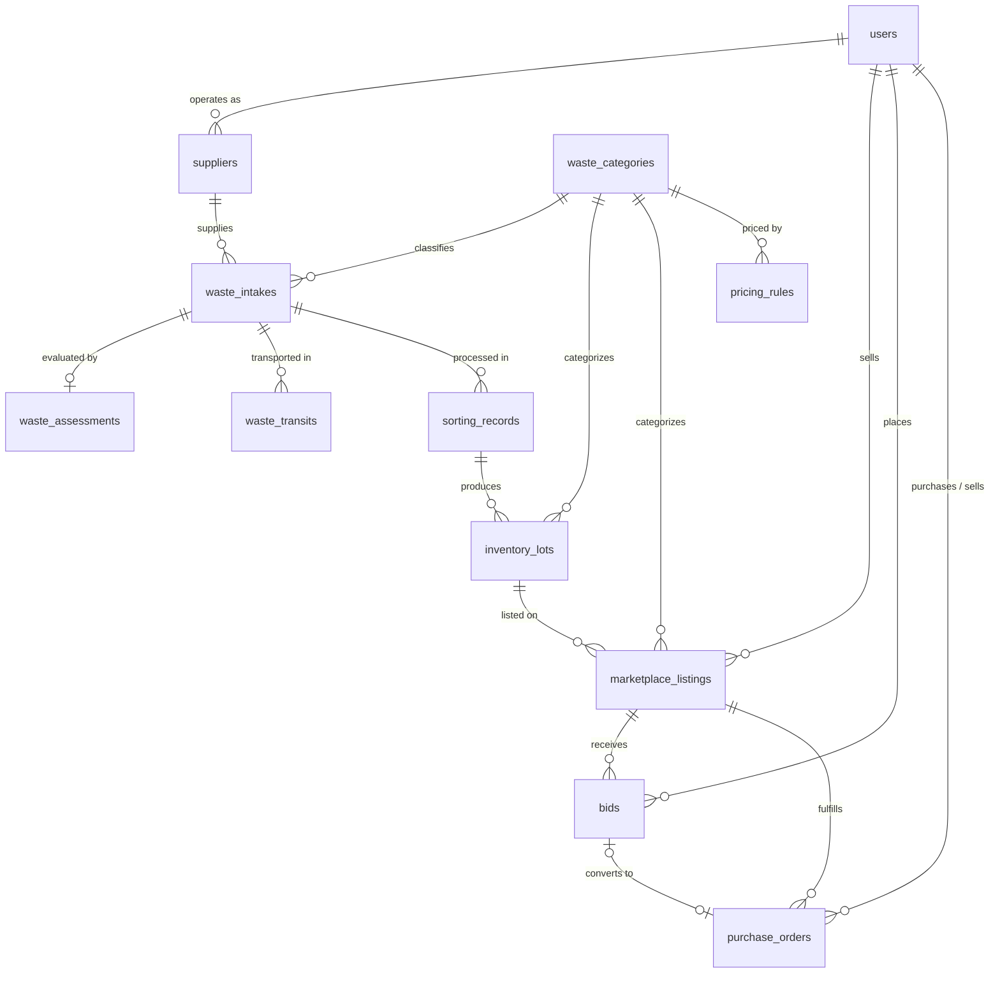

# Backend Database Schema Reference

This document serves as the comprehensive schema reference for the **Circular Waste & Resource Marketplace**, tracking table definitions, data types, constraints, relational entity mappings, and performance indexes.

---

## 1. Schema Overview & Relational Architecture

The database is built on **PostgreSQL 15+** with the **PostGIS** spatial extension. It models a circular lifecycle:
1. **Intake & Verification** (`users`, `suppliers`, `waste_intakes`, `waste_assessments`)
2. **Logistics & Telemetry** (`waste_transits`, `vehicle_telemetry`)
3. **Sorting & Inventory Management** (`sorting_records`, `inventory_lots`)
4. **B2B Marketplace & Dynamic Pricing** (`pricing_rules`, `marketplace_listings`, `bids`, `purchase_orders`)



---

## 2. Core Foundational Tables (Days 1–3 Recap)

### 2.1. `users`
Core user identity and authentication credentials.

| Column Name | Data Type | Constraints | Description |
| :--- | :--- | :--- | :--- |
| `id` | UUID | PK, DEFAULT `gen_random_uuid()` | Immutable internal identifier |
| `email` | VARCHAR(255) | UNIQUE, NOT NULL | Account email / login handle |
| `hashed_password` | VARCHAR(255) | NOT NULL | Bcrypt hash with salt |
| `full_name` | VARCHAR(120) | NOT NULL | Primary contact or corporate representative |
| `role` | VARCHAR(50) | NOT NULL | Role: `GENERATOR`, `RECYCLER`, `LOGISTICS`, `ADMIN` |
| `organization_name`| VARCHAR(255) | NULLABLE | Legal business entity name |
| `phone_number` | VARCHAR(30) | NULLABLE | E.164 formatted contact phone |
| `is_active` | BOOLEAN | NOT NULL, DEFAULT TRUE | Account operational status |
| `is_verified` | BOOLEAN | NOT NULL, DEFAULT FALSE | KYC/AML verification approval status |
| `created_at` | TIMESTAMPTZ | NOT NULL, DEFAULT NOW() | Record creation timestamp |
| `updated_at` | TIMESTAMPTZ | NOT NULL, DEFAULT NOW() | Last modification timestamp |

### 2.2. `suppliers`
KYC profile and facility geolocation for registered waste generators.

| Column Name | Data Type | Constraints | Description |
| :--- | :--- | :--- | :--- |
| `id` | UUID | PK, DEFAULT `gen_random_uuid()` | Supplier record identifier |
| `user_id` | UUID | FK (`users.id`), UNIQUE, NOT NULL | User account owning this profile |
| `business_name` | VARCHAR(255) | NOT NULL | Registered operating business title |
| `registration_number`| VARCHAR(100) | UNIQUE, NOT NULL | Tax ID / Commercial registration code |
| `facility_address` | TEXT | NOT NULL | Physical collection facility street address |
| `latitude` | DOUBLE PRECISION | NOT NULL | WGS-84 coordinate latitude |
| `longitude` | DOUBLE PRECISION | NOT NULL | WGS-84 coordinate longitude |
| `contact_phone` | VARCHAR(30) | NOT NULL | Direct facility dispatch contact |
| `verification_status`| VARCHAR(50) | NOT NULL, DEFAULT 'PENDING' | Status: `PENDING`, `VERIFIED`, `REJECTED` |
| `created_at` | TIMESTAMPTZ | NOT NULL, DEFAULT NOW() | Registration timestamp |
| `updated_at` | TIMESTAMPTZ | NOT NULL, DEFAULT NOW() | Profile update timestamp |

### 2.3. `waste_categories`
Taxonomy catalog for recyclable resources and carbon offset conversion factors.

| Column Name | Data Type | Constraints | Description |
| :--- | :--- | :--- | :--- |
| `id` | SERIAL | PK | Numeric taxonomy identifier |
| `code` | VARCHAR(50) | UNIQUE, NOT NULL | Unique enum slug (e.g. `PLASTIC_PET`, `FERROUS_METAL`) |
| `name` | VARCHAR(100) | NOT NULL | Human-readable material title |
| `unit_of_measure` | VARCHAR(20) | NOT NULL, DEFAULT 'kg' | Standard billing unit (typically `kg` or `tonne`) |
| `carbon_offset_factor` | DOUBLE PRECISION | NOT NULL, DEFAULT 1.5 | Estimated kg CO2e emissions avoided per kg recycled |
| `is_active` | BOOLEAN | NOT NULL, DEFAULT TRUE | Whether available for new listings |

### 2.4. `waste_intakes`
Consignment manifest tracking waste entering the marketplace pipeline.

| Column Name | Data Type | Constraints | Description |
| :--- | :--- | :--- | :--- |
| `id` | UUID | PK, DEFAULT `gen_random_uuid()` | Internal intake identifier |
| `batch_code` | VARCHAR(50) | UNIQUE, NOT NULL | Human-readable manifest code (`BATCH-YYYYMMDD-XXXX`) |
| `supplier_id` | UUID | FK (`suppliers.id`), NOT NULL | Waste generator who created the intake |
| `category_id` | INTEGER | FK (`waste_categories.id`), NOT NULL | Primary material classification |
| `purity_grade` | VARCHAR(20) | NOT NULL | Initial purity: `GRADE_A`, `GRADE_B`, `GRADE_C`, `CONTAMINATED` |
| `declared_weight_kg`| DOUBLE PRECISION | NOT NULL | Weight self-reported by supplier |
| `verified_weight_kg`| DOUBLE PRECISION | NULLABLE | Physical scale-measured weight |
| `weight_discrepancy_kg`| DOUBLE PRECISION | NULLABLE | Verified weight minus declared weight |
| `status` | VARCHAR(50) | NOT NULL, DEFAULT 'SUBMITTED' | `SUBMITTED`, `IN_TRANSIT`, `WEIGHED`, `VERIFIED`, `FLAGGED_DISCREPANCY` |
| `qr_code_hash` | VARCHAR(255) | NOT NULL | Cryptographic HMAC signature for offline scan verification |
| `image_paths` | JSONB | NOT NULL, DEFAULT '[]'::jsonb | Relative local upload paths for inspection photos |
| `notes` | TEXT | NULLABLE | Supplier consignment handling notes |
| `scale_operator_id`| UUID | FK (`users.id`), NULLABLE | Staff member recording physical scale measurement |
| `verified_at` | TIMESTAMPTZ | NULLABLE | Timestamp of physical scale weigh-in |
| `created_at` | TIMESTAMPTZ | NOT NULL, DEFAULT NOW() | Intake creation timestamp |
| `updated_at` | TIMESTAMPTZ | NOT NULL, DEFAULT NOW() | Manifest update timestamp |

---

## 3. Day 4: Sorting, B2B Marketplace & Pricing Engine

### 3.1. `sorting_records`
Audits the physical sorting, decontamination, and grading process converting raw intake consignments into standardized inventory lots.

| Column Name | Data Type | Constraints | Description |
| :--- | :--- | :--- | :--- |
| `id` | UUID | PK, DEFAULT `gen_random_uuid()` | Unique sorting operation ID |
| `intake_id` | UUID | FK (`waste_intakes.id`), NOT NULL | Raw waste consignment source |
| `facility_location`| VARCHAR(255) | NOT NULL | Processing/sorting hub identifier or name |
| `input_weight_kg` | DOUBLE PRECISION | NOT NULL | Gross raw weight fed into the sorting line |
| `sorted_yield_kg` | DOUBLE PRECISION | NOT NULL | Usable recyclable material recovered |
| `contamination_removed_kg` | DOUBLE PRECISION | NOT NULL | Discarded non-recyclable debris / moisture loss |
| `sorting_efficiency_percent` | DOUBLE PRECISION | NOT NULL | `(sorted_yield_kg / input_weight_kg) * 100` |
| `sorter_operator_id`| UUID | FK (`users.id`), NOT NULL | Sorting line supervisor / operator ID |
| `started_at` | TIMESTAMPTZ | NOT NULL | Sorting run start timestamp |
| `completed_at` | TIMESTAMPTZ | NOT NULL | Sorting run completion timestamp |
| `created_at` | TIMESTAMPTZ | NOT NULL, DEFAULT NOW() | Record creation timestamp |

#### Relationships:
* **Many-to-One with `waste_intakes`**: Many sorting operations can theoretically relate to an intake consignment (or 1-to-1 per completed intake).
* **Many-to-One with `users`**: Linked to `sorter_operator_id` as the supervisor logging the audit.
* **One-to-Many with `inventory_lots`**: A single sorting run can split an intake into multiple sorted inventory lots (e.g., separating Clear PET vs. Colored PET).

---

### 3.2. `inventory_lots`
Standardized, quality-certified warehouse inventory ready for commercial marketplace trading.

| Column Name | Data Type | Constraints | Description |
| :--- | :--- | :--- | :--- |
| `id` | UUID | PK, DEFAULT `gen_random_uuid()` | Unique inventory lot identifier |
| `lot_code` | VARCHAR(50) | UNIQUE, NOT NULL | Traceable lot number (`LOT-YYYYMMDD-XXXX`) |
| `sorting_record_id`| UUID | FK (`sorting_records.id`), NOT NULL | Originating sorting run ID |
| `category_id` | INTEGER | FK (`waste_categories.id`), NOT NULL | Certified material category |
| `purity_grade` | VARCHAR(20) | NOT NULL | Verified grade (`GRADE_A`, `GRADE_B`, `GRADE_C`) |
| `moisture_content_percent` | DOUBLE PRECISION | NOT NULL, DEFAULT 0.0 | Measured moisture percentage |
| `initial_quantity_kg` | DOUBLE PRECISION | NOT NULL | Original net mass put into inventory |
| `available_quantity_kg` | DOUBLE PRECISION | NOT NULL | Currently unsold/unreserved mass |
| `reserved_quantity_kg` | DOUBLE PRECISION | NOT NULL, DEFAULT 0.0 | Mass held under active bids or escrow orders |
| `warehouse_location` | VARCHAR(100) | NOT NULL | Bay / Aisle / Silo storage address |
| `status` | VARCHAR(50) | NOT NULL, DEFAULT 'AVAILABLE' | `AVAILABLE`, `LISTED`, `ALLOCATED`, `DEPLETED` |
| `created_at` | TIMESTAMPTZ | NOT NULL, DEFAULT NOW() | Stock creation timestamp |
| `updated_at` | TIMESTAMPTZ | NOT NULL, DEFAULT NOW() | Inventory balance update timestamp |

#### Relationships:
* **Many-to-One with `sorting_records`**: Originates from a specific sorting operation.
* **Many-to-One with `waste_categories`**: Belongs to a certified material taxonomy.
* **One-to-Many with `marketplace_listings`**: One inventory lot can be divided or listed on the B2B marketplace.

---

### 3.3. `pricing_rules`
Defines dynamic pricing baselines, floor prices, and grade/moisture penalty algorithms.

| Column Name | Data Type | Constraints | Description |
| :--- | :--- | :--- | :--- |
| `id` | SERIAL | PK | Pricing rule identifier |
| `category_id` | INTEGER | FK (`waste_categories.id`), NOT NULL | Material category governed by this rule |
| `purity_grade` | VARCHAR(20) | NOT NULL | Target purity grade |
| `base_benchmark_price_per_kg` | DOUBLE PRECISION | NOT NULL | Market reference index price ($/kg) |
| `floor_price_per_kg` | DOUBLE PRECISION | NOT NULL | Minimum acceptable price threshold |
| `ceiling_price_per_kg` | DOUBLE PRECISION | NOT NULL | Maximum ceiling reference price |
| `moisture_penalty_multiplier` | DOUBLE PRECISION | NOT NULL, DEFAULT 0.02 | Price deduction per 1% excess moisture |
| `contamination_penalty_multiplier` | DOUBLE PRECISION | NOT NULL, DEFAULT 0.05 | Price deduction per 1% contamination |
| `is_active` | BOOLEAN | NOT NULL, DEFAULT TRUE | Whether rule is actively enforced |
| `effective_from` | TIMESTAMPTZ | NOT NULL, DEFAULT NOW() | Rule activation timestamp |
| `effective_to` | TIMESTAMPTZ | NULLABLE | Rule sunset / expiration timestamp |

#### Relationships:
* **Many-to-One with `waste_categories`**: Associated with specific material types.
* **Referenced by Marketplace Engine**: Used in pricing calculations at listing and bidding time.

---

### 3.4. `marketplace_listings`
Commercial offers for sorted recyclable lots published by generators/processors.

| Column Name | Data Type | Constraints | Description |
| :--- | :--- | :--- | :--- |
| `id` | UUID | PK, DEFAULT `gen_random_uuid()` | Unique listing identifier |
| `listing_code` | VARCHAR(50) | UNIQUE, NOT NULL | Human-readable listing slug (`LIST-YYYYMMDD-XXXX`) |
| `seller_id` | UUID | FK (`users.id`), NOT NULL | User account listing the material |
| `inventory_lot_id` | UUID | FK (`inventory_lots.id`), NOT NULL | Underlying physical inventory lot |
| `category_id` | INTEGER | FK (`waste_categories.id`), NOT NULL | Material category |
| `title` | VARCHAR(255) | NOT NULL | Commercial headline (e.g. "Baled Clear PET Flakes - Grade A") |
| `description` | TEXT | NULLABLE | Detailed material specifications & packaging |
| `purity_grade` | VARCHAR(20) | NOT NULL | Material grade offered |
| `listing_type` | VARCHAR(30) | NOT NULL, DEFAULT 'FIXED_PRICE' | `FIXED_PRICE`, `AUCTION_BIDDING` |
| `available_quantity_kg`| DOUBLE PRECISION | NOT NULL | Quantity available for this listing |
| `min_order_quantity_kg`| DOUBLE PRECISION | NOT NULL, DEFAULT 100.0 | Minimum order quantity (MOQ) |
| `unit_price_per_kg` | DOUBLE PRECISION | NOT NULL | Fixed asking price or auction starting price ($/kg) |
| `calculated_floor_price`| DOUBLE PRECISION | NOT NULL | Algorithmic minimum floor from `pricing_rules` |
| `estimated_co2_offset_total`| DOUBLE PRECISION | NOT NULL | Precalculated emissions offset (`kg * factor`) |
| `status` | VARCHAR(50) | NOT NULL, DEFAULT 'ACTIVE' | `DRAFT`, `ACTIVE`, `RESERVED`, `SOLD_OUT`, `CANCELLED` |
| `auction_ends_at` | TIMESTAMPTZ | NULLABLE | Expiry timestamp for auction listings |
| `created_at` | TIMESTAMPTZ | NOT NULL, DEFAULT NOW() | Listing publication timestamp |
| `updated_at` | TIMESTAMPTZ | NOT NULL, DEFAULT NOW() | Listing modification timestamp |

#### Relationships:
* **Many-to-One with `users` (`seller_id`)**: Merchant or recycler creating the offer.
* **Many-to-One with `inventory_lots`**: Ties market listing to verifiable warehouse inventory.
* **Many-to-One with `waste_categories`**: Material categorization.
* **One-to-Many with `bids`**: Holds multiple competing bids if `listing_type = 'AUCTION_BIDDING'`.
* **One-to-Many with `purchase_orders`**: Fulfillments against this listing.

---

### 3.5. `bids`
B2B procurement bids placed by certified buyers on auction listings or negotiated lots.

| Column Name | Data Type | Constraints | Description |
| :--- | :--- | :--- | :--- |
| `id` | UUID | PK, DEFAULT `gen_random_uuid()` | Unique bid identifier |
| `listing_id` | UUID | FK (`marketplace_listings.id`), NOT NULL | Target listing |
| `buyer_id` | UUID | FK (`users.id`), NOT NULL | Buyer making the bid |
| `bid_price_per_kg` | DOUBLE PRECISION | NOT NULL | Price offered per kilogram ($/kg) |
| `requested_quantity_kg` | DOUBLE PRECISION | NOT NULL | Mass requested by buyer |
| `total_bid_amount` | DOUBLE PRECISION | NOT NULL | `bid_price_per_kg * requested_quantity_kg` |
| `status` | VARCHAR(30) | NOT NULL, DEFAULT 'PENDING' | `PENDING`, `ACCEPTED`, `REJECTED`, `OUTBID`, `EXPIRED` |
| `valid_until` | TIMESTAMPTZ | NOT NULL | Bid offer validity deadline |
| `created_at` | TIMESTAMPTZ | NOT NULL, DEFAULT NOW() | Bid submission timestamp |
| `updated_at` | TIMESTAMPTZ | NOT NULL, DEFAULT NOW() | Bid status update timestamp |

#### Relationships:
* **Many-to-One with `marketplace_listings`**: Target listing for the bid.
* **Many-to-One with `users` (`buyer_id`)**: Purchasing organization.
* **One-to-One with `purchase_orders`**: When a bid is accepted, it converts into a purchase order.

---

### 3.6. `purchase_orders`
Binding commercial contracts and escrow allocations between buyers and sellers.

| Column Name | Data Type | Constraints | Description |
| :--- | :--- | :--- | :--- |
| `id` | UUID | PK, DEFAULT `gen_random_uuid()` | Unique purchase order ID |
| `order_number` | VARCHAR(50) | UNIQUE, NOT NULL | Invoice/PO reference (`PO-YYYYMMDD-XXXX`) |
| `listing_id` | UUID | FK (`marketplace_listings.id`), NOT NULL | Source marketplace listing |
| `buyer_id` | UUID | FK (`users.id`), NOT NULL | Purchasing user/organization |
| `seller_id` | UUID | FK (`users.id`), NOT NULL | Supplying user/organization |
| `accepted_bid_id` | UUID | FK (`bids.id`), NULLABLE | Bid reference if originated from an auction |
| `quantity_kg` | DOUBLE PRECISION | NOT NULL | Contracted mass in kg |
| `unit_price_per_kg` | DOUBLE PRECISION | NOT NULL | Contracted price per kg |
| `subtotal_amount` | DOUBLE PRECISION | NOT NULL | `quantity_kg * unit_price_per_kg` |
| `platform_fee_amount` | DOUBLE PRECISION | NOT NULL | Platform commission (e.g. 2.5%) |
| `total_gross_amount` | DOUBLE PRECISION | NOT NULL | `subtotal_amount + platform_fee_amount` |
| `payment_status` | VARCHAR(30) | NOT NULL, DEFAULT 'PENDING' | `PENDING`, `ESCROW_HELD`, `RELEASED`, `REFUNDED` |
| `fulfillment_status`| VARCHAR(30) | NOT NULL, DEFAULT 'PENDING' | `PENDING`, `READY_FOR_PICKUP`, `IN_TRANSIT`, `DELIVERED`, `DISPUTED` |
| `created_at` | TIMESTAMPTZ | NOT NULL, DEFAULT NOW() | Order generation timestamp |
| `updated_at` | TIMESTAMPTZ | NOT NULL, DEFAULT NOW() | Order status update timestamp |

#### Relationships:
* **Many-to-One with `marketplace_listings`**: Source commercial listing.
* **Many-to-One with `users` (`buyer_id`)**: Buyer party.
* **Many-to-One with `users` (`seller_id`)**: Seller party.
* **Many-to-One with `bids` (`accepted_bid_id`)**: Bid converting into this order (if applicable).

---

## 4. Performance Indexes & Integrity Constraints

```sql
-- 1. Sorting & Inventory Integrity & Lookups
CREATE INDEX idx_sorting_intake ON sorting_records(intake_id);
CREATE INDEX idx_sorting_completed ON sorting_records(completed_at DESC);
CREATE INDEX idx_inventory_lot_code ON inventory_lots(lot_code);
CREATE INDEX idx_inventory_category_grade ON inventory_lots(category_id, purity_grade, status);

-- 2. Marketplace Catalog High-Frequency Query Filtering
-- Optimizes GET /api/v1/marketplace/listings with category, price range, and active status
CREATE INDEX idx_listings_catalog_search ON marketplace_listings(category_id, status, unit_price_per_kg);
CREATE INDEX idx_listings_seller ON marketplace_listings(seller_id, status);

-- 3. Bids Ordering & Fast Auction Resolution
-- Optimizes retrieving top active bids for a listing
CREATE INDEX idx_bids_listing_rank ON bids(listing_id, bid_price_per_kg DESC, created_at ASC);
CREATE INDEX idx_bids_buyer ON bids(buyer_id, status);

-- 4. Purchase Order Lookups
CREATE INDEX idx_po_number ON purchase_orders(order_number);
CREATE INDEX idx_po_buyer ON purchase_orders(buyer_id, fulfillment_status);
CREATE INDEX idx_po_seller ON purchase_orders(seller_id, fulfillment_status);

-- 5. Business Logic Check Constraints
ALTER TABLE inventory_lots 
    ADD CONSTRAINT chk_inventory_qty_positive 
    CHECK (initial_quantity_kg > 0 AND available_quantity_kg >= 0 AND reserved_quantity_kg >= 0);

ALTER TABLE marketplace_listings 
    ADD CONSTRAINT chk_listing_quantities 
    CHECK (available_quantity_kg > 0 AND min_order_quantity_kg > 0 AND available_quantity_kg >= min_order_quantity_kg);

ALTER TABLE marketplace_listings 
    ADD CONSTRAINT chk_listing_unit_price 
    CHECK (unit_price_per_kg > 0 AND unit_price_per_kg >= calculated_floor_price);

ALTER TABLE bids 
    ADD CONSTRAINT chk_bid_values 
    CHECK (bid_price_per_kg > 0 AND requested_quantity_kg > 0 AND total_bid_amount > 0);

ALTER TABLE purchase_orders 
    ADD CONSTRAINT chk_po_amounts 
    CHECK (quantity_kg > 0 AND unit_price_per_kg > 0 AND total_gross_amount > 0);
```

---

## 5. Day 6: B2C Eco-Store, Green Rewards & Payments

### 5.1. `reward_wallets`
Tracks green points accrued by waste suppliers for verified deliveries.

| Column Name | Data Type | Constraints | Description |
| :--- | :--- | :--- | :--- |
| `id` | UUID | PK, DEFAULT `gen_random_uuid()` | Unique wallet ID |
| `user_id` | UUID | FK (`users.id`), UNIQUE, NOT NULL | Account holding this wallet |
| `available_points` | INTEGER | NOT NULL, DEFAULT 0 | Current spendable green points balance |
| `lifetime_earned` | INTEGER | NOT NULL, DEFAULT 0 | Total points accrued across all verified intakes |
| `lifetime_redeemed`| INTEGER | NOT NULL, DEFAULT 0 | Total points spent in Eco-Store |
| `updated_at` | TIMESTAMPTZ | NOT NULL, DEFAULT NOW() | Last wallet modification timestamp |

#### Relationships:
* **One-to-One with `users`**: Each registered user/supplier has exactly one reward wallet.
* **One-to-Many with `reward_transactions`**: Ledger history of points credited and debited.

---

### 5.2. `reward_transactions`
Immutable audit ledger of all green points activity.

| Column Name | Data Type | Constraints | Description |
| :--- | :--- | :--- | :--- |
| `id` | BIGSERIAL | PK | Transaction ledger sequence |
| `wallet_id` | UUID | FK (`reward_wallets.id`), NOT NULL | Associated reward wallet |
| `intake_id` | UUID | FK (`waste_intakes.id`), NULLABLE | Source intake batch (if point credit) |
| `order_id` | UUID | NULLABLE | Associated Eco-Store order (if point redemption) |
| `points_delta` | INTEGER | NOT NULL | Positive for earnings, negative for redemption |
| `transaction_type` | VARCHAR(30) | NOT NULL | `INTAKE_CREDIT`, `STORE_REDEMPTION`, `BONUS_GRANT` |
| `description` | VARCHAR(255) | NOT NULL | Audit memorandum |
| `created_at` | TIMESTAMPTZ | NOT NULL, DEFAULT NOW() | Timestamp of ledger entry |

---

### 5.3. `eco_products`
Upcycled and recycled consumer goods available in the B2C Eco-Store.

| Column Name | Data Type | Constraints | Description |
| :--- | :--- | :--- | :--- |
| `id` | UUID | PK, DEFAULT `gen_random_uuid()` | Unique product identifier |
| `title` | VARCHAR(255) | NOT NULL | Product name (e.g. "Organic Bio-Compost 25kg") |
| `slug` | VARCHAR(255) | UNIQUE, NOT NULL | SEO URL slug |
| `description` | TEXT | NOT NULL | Product specifications and circular origin story |
| `category` | VARCHAR(50) | NOT NULL | `COMPOST`, `RECYCLED_PLASTIC`, `UPCYCLED_GOODS` |
| `price_fiat` | DOUBLE PRECISION | NOT NULL | Retail cash price ($ / ₹) |
| `max_points_discount_percent` | DOUBLE PRECISION | NOT NULL, DEFAULT 50.0 | Max % of price payable via Green Points |
| `stock_quantity` | INTEGER | NOT NULL, DEFAULT 0 | Real-time units available |
| `carbon_offset_kg` | DOUBLE PRECISION | NOT NULL, DEFAULT 0.0 | Net embodied carbon avoided by this purchase |
| `image_url` | VARCHAR(500) | NOT NULL | Product photo path |
| `is_featured` | BOOLEAN | NOT NULL, DEFAULT FALSE | Highlight on landing page showcase |
| `created_at` | TIMESTAMPTZ | NOT NULL, DEFAULT NOW() | Creation timestamp |

---

### 5.4. `eco_orders`
Consumer orders placed through the Eco-Store.

| Column Name | Data Type | Constraints | Description |
| :--- | :--- | :--- | :--- |
| `id` | UUID | PK, DEFAULT `gen_random_uuid()` | Unique order identifier |
| `order_number` | VARCHAR(50) | UNIQUE, NOT NULL | Customer-facing receipt code (`ECO-YYYYMMDD-XXXX`) |
| `user_id` | UUID | FK (`users.id`), NOT NULL | Customer placing order |
| `gross_amount` | DOUBLE PRECISION | NOT NULL | Total product retail value |
| `points_redeemed` | INTEGER | NOT NULL, DEFAULT 0 | Green points deducted |
| `points_discount_amount` | DOUBLE PRECISION | NOT NULL, DEFAULT 0.0 | Cash discount equivalent of redeemed points |
| `net_payable_amount` | DOUBLE PRECISION | NOT NULL | Net cash charged to payment gateway |
| `payment_status` | VARCHAR(30) | NOT NULL, DEFAULT 'PENDING' | `PENDING`, `COMPLETED`, `FAILED`, `REFUNDED` |
| `payment_gateway_ref` | VARCHAR(100) | NULLABLE | Mock transaction / UPI UTR reference |
| `shipping_address` | TEXT | NOT NULL | Delivery destination address |
| `items_snapshot` | JSONB | NOT NULL | Cart snapshot `[{product_id, qty, unit_price}]` |
| `created_at` | TIMESTAMPTZ | NOT NULL, DEFAULT NOW() | Order placement timestamp |

#### Performance Indexes for Day 6:
```sql
CREATE INDEX idx_reward_wallet_user ON reward_wallets(user_id);
CREATE INDEX idx_reward_tx_wallet ON reward_transactions(wallet_id, created_at DESC);
CREATE INDEX idx_eco_products_cat_stock ON eco_products(category, stock_quantity);
CREATE INDEX idx_eco_orders_user ON eco_orders(user_id, created_at DESC);
```

