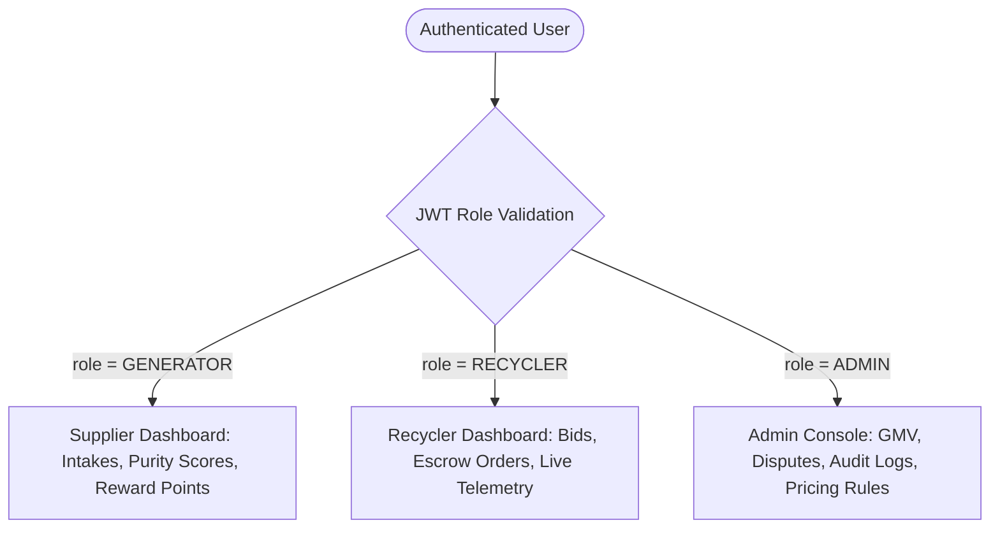
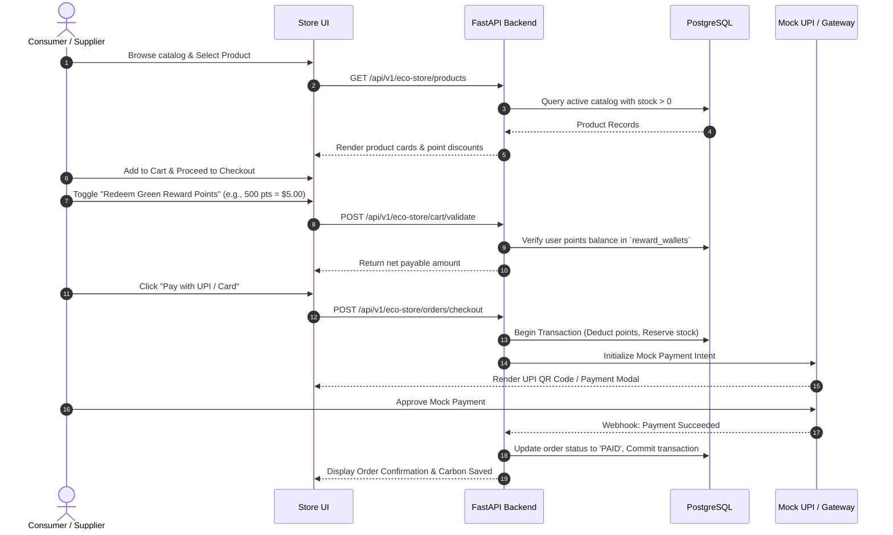

# Product Requirements Document (PRD)

**Project:** Circular Waste & Resource Marketplace  
**Document Code:** PRD-001  
**Sprint Cycle:** Day 6 - Premium Commercial Website, Dashboards & B2C Eco-Store  
**Author:** Lead Solutions Architect & Technical Documentation Writer  
**Status:** Approved for Implementation  

---

## 1. Feature Overview

Day 6 expands the Circular Waste Marketplace from an industrial B2B trading protocol into an end-to-end commercial ecosystem featuring:

1. **Commercial Landing Portal:** A public, high-conversion landing page presenting the circular economy platform, real-time platform impact statistics (total kg recycled, CO2e averted, active suppliers), interactive material calculators, and clear role-based onboarding CTAs.
2. **Role-Specific Executive Dashboards:** Dedicated analytical control centers tailored for:
   * **Waste Generators (Suppliers):** Tracking total intake tonnage, verification rates, contamination penalties, and earned Green Reward Points.
   * **Recyclers / Industrial Buyers:** Monitoring active procurement bids, escrow orders, inventory dispatch transit tracks, and ESG compliance reports.
   * **Platform Admins:** High-level platform health, aggregate marketplace gross merchandise value (GMV), dispute resolutions, and facility operations.
3. **B2C Eco-Store & Green Reward Points Redemption System:** A consumer-facing storefront where upcycled products (e.g., certified compost, recycled plastic pavers, repurposed packaging) can be purchased via direct currency or discounted by redeeming Green Reward Points accrued by waste generators.
4. **Interactive Carbon Impact Visualizer:** Real-time metrics demonstrating Scope 3 greenhouse gas mitigation, energy savings, and landfill diversion credits.

---

## 2. User Personas Addressed

| Persona | Role | Key Goals & Motivations | Primary Pain Points Solved |
| :--- | :--- | :--- | :--- |
| **P1: Industrial Waste Supplier** | `GENERATOR` | Monetize industrial byproduct scrap; track facility ESG compliance; redeem reward points for operational equipment or upcycled consumables. | Transparent verification without unfair deductions; instant rewards for high-purity segregation. |
| **P2: Industrial Recycler / Manufacturer** | `RECYCLER` | Procure reliable, sorted, contamination-free secondary raw materials with verified provenance and traceability. | Unreliable material quality; opaque broker pricing; absence of digital chain-of-custody. |
| **P3: Conscious Consumer / B2C Buyer** | `CONSUMER` | Purchase verified sustainable, upcycled circular products (e.g., organic compost, recycled PET goods) with proof of impact. | Greenwashing; lack of verifiable sustainability metrics on consumer goods. |
| **P4: Platform Administrator** | `ADMIN` | Oversee network operations, monitor escrow security, audit weighbridge discrepancies, and manage material pricing indices. | Fragmented data streams; manual dispute reconciliation. |

---

## 3. Functional Requirements

### 3.1. Public Commercial Landing Experience
* **FR-1.1:** The homepage must dynamically fetch aggregated sustainability metrics (`GET /api/v1/metrics/public-impact`), displaying:
  * Total waste diverted from landfills ($\text{Metric Tonnes}$).
  * Net carbon emissions avoided ($\text{kg CO}_2\text{e}$).
  * Total circular payout distributed to suppliers.
* **FR-1.2:** Interactive Circular Savings Calculator allowing visitors to input estimated waste production (by category and tonnage) to compute projected earnings and carbon offset credits before signing up.
* **FR-1.3:** Seamless role-directed onboarding routes routing users to targeted KYC questionnaires (`/register?role=GENERATOR`, `/register?role=RECYCLER`, or `/store`).

### 3.2. Role-Based Analytical Dashboards

#### Supplier Dashboard (`/dashboard/supplier`)
* **FR-2.1:** Displays intake batches grouped by status (`SUBMITTED`, `IN_TRANSIT`, `WEIGHED`, `VERIFIED`, `FLAGGED_DISCREPANCY`).
* **FR-2.2:** Real-time Purity & Quality rating with visual breakdown of AI contamination inspections (`GET /api/v1/dashboards/supplier/quality-trend`).
* **FR-2.3:** Green Rewards Wallet widget showing current available balance, lifetime points earned, and direct link to Eco-Store redemption.

#### Recycler / Buyer Dashboard (`/dashboard/recycler`)
* **FR-2.4:** Live Bidding & Purchase Order management tracking active auction lots, escrow payment statuses, and consignment dispatch alerts.
* **FR-2.5:** Embedded Leaflet.js interactive map widget displaying active in-transit shipments with live GPS position and estimated arrival markers (`WS /ws/tracking/{transit_id}`).
* **FR-2.6:** One-click ESG Certificate Generator exporting tamper-evident PDF reports of verified circular material procurement.

### 3.3. B2C Eco-Store & Reward Redemption Flow

#### Detailed Step-by-Step Checkout Actions:
1. **Catalog Browsing:** User accesses `/store`, filtering products by category (`COMPOST`, `RECYCLED_PLASTIC`, `UPCYCLED_FASHION`, `BUILDING_BLOCKS`).
2. **Item Selection & Stock Check:** User clicks "Add to Cart". Frontend initiates a real-time reservation check to ensure inventory is not exhausted (`inventory_lots.available_quantity_kg > 0`).
3. **Reward Points Application:** 
   * If logged in as an authenticated user with an active `reward_wallets` balance, a slider allows redeeming up to 50% of the cart value using points ($100\text{ points} = \$1.00\text{ discount}$).
   * The backend validates that requested points $\le \text{wallet.available\_points}$ and calculates $\text{Net Payable} = \text{Gross Amount} - \text{Points Value} + \text{Shipping}$.
4. **Mock UPI Payment Gateway:**
   * Backend generates a mock payment intent (`POST /api/v1/payments/mock-intent`).
   * Frontend displays a realistic UPI QR code interface (e.g., PhonePe / Google Pay / Paytm simulation) alongside a "Simulate Instant Payment Success" developer button for judges.
5. **Order Confirmation & Impact Receipt:**
   * Upon payment confirmation, points are debited in `reward_transactions`, product stock is reduced, and a purchase receipt displays the physical kilograms of recycled waste diverted by buying the item.

---

## 4. Technical Specifications & Endpoints

### 4.1. Exact API Routes Implemented

| Method | Route | Description | Auth Required |
| :--- | :--- | :--- | :--- |
| `GET` | `/api/v1/metrics/public-impact` | Public aggregate circular metrics for landing page | None |
| `GET` | `/api/v1/dashboards/supplier/summary` | Tonnage, intake statuses, purity trends, and reward wallet balance | `GENERATOR` |
| `GET` | `/api/v1/dashboards/recycler/summary` | Active bids, escrow purchases, transit tracking, ESG procurement stats | `RECYCLER` |
| `GET` | `/api/v1/dashboards/admin/overview` | Platform GMV, total tonnage, active transit count, dispute flags | `ADMIN` |
| `GET` | `/api/v1/eco-store/products` | Browse upcycled/consumer products with stock and points pricing | None / Optional |
| `GET` | `/api/v1/eco-store/products/{id}` | Detailed product specifications, material origins, and carbon rating | None |
| `POST` | `/api/v1/eco-store/cart/validate` | Validate cart items, inventory availability, and applicable reward points | Any Authenticated |
| `POST` | `/api/v1/eco-store/orders/checkout` | Create B2C order, apply point deduction, and generate mock payment session | Any Authenticated |
| `POST` | `/api/v1/payments/mock-webhook` | Process mock UPI payment gateway callback | System / Mock |
| `GET` | `/api/v1/rewards/wallet` | Query authenticated user's current points balance & transaction log | Any Authenticated |

### 4.2. Database Schema Extensions

#### Table: `reward_wallets`
Tracks green points awarded to waste suppliers for verified deliveries.

| Column Name | Data Type | Constraints | Description |
| :--- | :--- | :--- | :--- |
| `id` | UUID | PK, DEFAULT `gen_random_uuid()` | Unique wallet ID |
| `user_id` | UUID | FK (`users.id`), UNIQUE, NOT NULL | Account holding this wallet |
| `available_points` | INTEGER | NOT NULL, DEFAULT 0 | Current spendable green points balance |
| `lifetime_earned` | INTEGER | NOT NULL, DEFAULT 0 | Total points accrued across all verified intakes |
| `lifetime_redeemed`| INTEGER | NOT NULL, DEFAULT 0 | Total points spent in Eco-Store |
| `updated_at` | TIMESTAMPTZ | NOT NULL, DEFAULT NOW() | Last wallet modification timestamp |

#### Table: `reward_transactions`
Immutable ledger of all points credited or debited.

| Column Name | Data Type | Constraints | Description |
| :--- | :--- | :--- | :--- |
| `id` | BIGSERIAL | PK | Transaction ledger sequence |
| `wallet_id` | UUID | FK (`reward_wallets.id`), NOT NULL | Associated reward wallet |
| `intake_id` | UUID | FK (`waste_intakes.id`), NULLABLE | Source intake batch if credit |
| `order_id` | UUID | NULLABLE | Associated Eco-Store order if debit |
| `points_delta` | INTEGER | NOT NULL | Positive for earnings, negative for redemption |
| `transaction_type` | VARCHAR(30) | NOT NULL | `INTAKE_CREDIT`, `STORE_REDEMPTION`, `BONUS_GRANT` |
| `description` | VARCHAR(255) | NOT NULL | Audit memorandum |
| `created_at` | TIMESTAMPTZ | NOT NULL, DEFAULT NOW() | Timestamp of ledger entry |

#### Table: `eco_products`
Upcycled and recycled consumer goods available in the B2C Eco-Store.

| Column Name | Data Type | Constraints | Description |
| :--- | :--- | :--- | :--- |
| `id` | UUID | PK, DEFAULT `gen_random_uuid()` | Unique product identifier |
| `title` | VARCHAR(255) | NOT NULL | Product name (e.g., "Organic Bio-Compost 25kg") |
| `slug` | VARCHAR(255) | UNIQUE, NOT NULL | SEO URL slug |
| `description` | TEXT | NOT NULL | Product specifications and circular origin story |
| `category` | VARCHAR(50) | NOT NULL | `COMPOST`, `RECYCLED_PLASTIC`, `UPCYCLED_GOODS` |
| `price_fiat` | DOUBLE PRECISION | NOT NULL | Retail cash price ($ / ₹) |
| `max_points_discount_percent` | DOUBLE PRECISION | NOT NULL, DEFAULT 50.0 | Max % of price payable via Green Points |
| `stock_quantity` | INTEGER | NOT NULL, DEFAULT 0 | Real-time units available |
| `carbon_offset_kg` | DOUBLE PRECISION | NOT NULL, DEFAULT 0.0 | Net embodied carbon avoided by this purchase |
| `image_url` | VARCHAR(500) | NOT NULL | Product photo path |
| `is_featured` | BOOLEAN | NOT NULL, DEFAULT FALSE | Highlight on landing page showcase |
| `created_at` | TIMESTAMPTZ | NOT NULL, DEFAULT NOW() | Creation timestamp |

#### Table: `eco_orders`
Consumer orders placed through the Eco-Store.

| Column Name | Data Type | Constraints | Description |
| :--- | :--- | :--- | :--- |
| `id` | UUID | PK, DEFAULT `gen_random_uuid()` | Unique order identifier |
| `order_number` | VARCHAR(50) | UNIQUE, NOT NULL | Customer-facing receipt code (`ECO-YYYYMMDD-XXXX`) |
| `user_id` | UUID | FK (`users.id`), NOT NULL | Customer placing order |
| `gross_amount` | DOUBLE PRECISION | NOT NULL | Total product retail value |
| `points_redeemed` | INTEGER | NOT NULL, DEFAULT 0 | Green points deducted |
| `points_discount_amount` | DOUBLE PRECISION | NOT NULL, DEFAULT 0.0 | Cash discount equivalent of redeemed points |
| `net_payable_amount` | DOUBLE PRECISION | NOT NULL | Net cash charged to payment gateway |
| `payment_status` | VARCHAR(30) | NOT NULL, DEFAULT 'PENDING' | `PENDING`, `COMPLETED`, `FAILED`, `REFUNDED` |
| `payment_gateway_ref` | VARCHAR(100) | NULLABLE | Mock transaction / UPI UTR reference |
| `shipping_address` | TEXT | NOT NULL | Delivery destination address |
| `items_snapshot` | JSONB | NOT NULL | Cart snapshot `[{product_id, qty, unit_price}]` |
| `created_at` | TIMESTAMPTZ | NOT NULL, DEFAULT NOW() | Order placement timestamp |

---

## 5. Acceptance Criteria

| ID | Category | Scenario / Rule | Expected System Behavior |
| :--- | :--- | :--- | :--- |
| **AC-01** | Landing | Public visitor visits `/` | Page loads without authentication; live statistics match database counts from `waste_intakes` and `waste_assessments`. |
| **AC-02** | Dashboard | Unauthenticated user accesses `/dashboard/*` | User is redirected to `/login?next=...` with 401 Unauthorized. |
| **AC-03** | Dashboard | User with role `GENERATOR` visits `/dashboard/recycler` | Access denied (HTTP 403 Forbidden); redirected to their appropriate supplier portal. |
| **AC-04** | Eco-Store | User adds product with `stock_quantity = 0` | "Add to Cart" button is disabled; API responds with HTTP 400 "Insufficient stock". |
| **AC-05** | Rewards | User attempts to apply more points than available | Checkout calculation clamps to maximum available points; API rejects fraudulent requests with HTTP 422. |
| **AC-06** | Rewards | Points double-redemption prevention | Points deduction occurs within an ACID transaction with `SELECT available_points FROM reward_wallets WHERE user_id = ... FOR UPDATE`. Points cannot be double-spent across concurrent tabs. |
| **AC-07** | Payment | User completes mock UPI payment | Payment status updates to `COMPLETED`; `eco_products.stock_quantity` decrements by purchased quantity; transaction logged in `reward_transactions`. |
| **AC-08** | Carbon Impact | Order confirmation screen renders | Screen displays exact carbon avoided metric (`kg CO2e`) derived from products purchased. |

---

## 6. Non-Functional Requirements (NFRs)

### 6.1. Performance & Latency
* **Page Load Speed:** Landing page and dashboard shell must achieve Largest Contentful Paint (LCP) under **1.8 seconds** on standard 4G networks.
* **API Response Time:** Read endpoints (`GET /api/v1/metrics/public-impact`, `GET /api/v1/eco-store/products`) must respond in **$\le 120\text{ ms}$** at p95 using indexed PostgreSQL queries.
* **Cart Calculation:** Points and price calculation (`POST /api/v1/eco-store/cart/validate`) must resolve in under **80 ms**.

### 6.2. Usability & Device Responsiveness
* **Mobile First Design:** All interfaces (Landing page, Supplier Intake Tracker, Eco-Store, and Mock UPI screen) must be 100% responsive across mobile ($360\text{px}$ width), tablet, and desktop viewports.
* **Touch Optimization:** Touch targets on mobile (e.g., "Scan QR", "Redeem Points", "Approve Payment") must maintain a minimum bounding box of $48 \times 48\text{ px}$.

### 6.3. Security & Financial Integrity
* **Tamper-Proof Calculations:** All monetary totals, points-to-cash conversions, and discount caps must be calculated strictly on the backend. Frontend-submitted totals are ignored and recomputed server-side.
* **Strict Role Segregation:** Dashboards enforce JWT bearer claims (`sub`, `role`) with FastAPI dependency injection (`Depends(get_current_active_user)` and `Depends(require_role(["GENERATOR"]))`).
* **Zero Real Financial Liability:** Mock payment flow uses sandboxed simulations; no real bank account or credit card processing is executed during hackathon demonstration.
