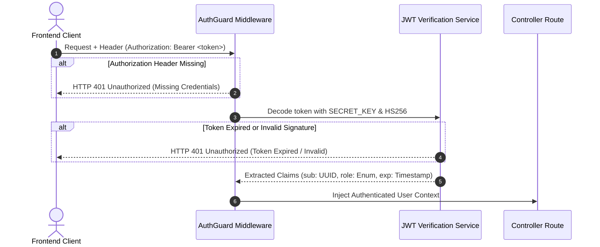

# Technical Requirements Document (TRD)

**Project:** Circular Waste & Resource Marketplace  
**Document Code:** TRD-001  
**Sprint Cycle:** Day 2 - Supplier Registration & Waste Intake APIs  
**Architect:** Solutions Architect & Technical Documentation Writer  
**Status:** Approved for Implementation  

---

## 1. System Overview

Day 2 delivers the core supplier onboarding and waste intake ingestion engine. This subsystem enables industrial and commercial waste generators to register verified facility profiles, submit waste consignment declarations with photo evidence, generate tamper-evident QR code transit manifests, and facilitate physical weighbridge verification.

---

## 2. API Contracts & Endpoint Specifications

### 2.1. Summary Endpoint Matrix

| HTTP Method & Endpoint | Request Payload Type | Response Payload Type | Auth Required | Role Required | Description |
| :--- | :--- | :--- | :--- | :--- | :--- |
| `POST /api/v1/suppliers/profile` | `application/json` | `application/json` | Yes | `GENERATOR` | Complete supplier KYC, corporate details & facility coordinates |
| `GET /api/v1/suppliers/me` | None | `application/json` | Yes | `GENERATOR` | Retrieve authenticated supplier profile and verification state |
| `POST /api/v1/intake/create` | `multipart/form-data` | `application/json` | Yes | `GENERATOR` | Ingest waste declaration, purity estimate, and proof photos |
| `GET /api/v1/intake/{intake_id}` | None | `application/json` | Yes | Any Authenticated | Fetch full intake manifest, photo URLs, and status history |
| `GET /api/v1/intake/{intake_id}/qr` | None | `application/json` | Yes | Any Authenticated | Fetch base64 data-URL and cryptographic signature of the QR code |
| `GET /api/v1/intake/scan/{batch_code}`| None | `application/json` | Yes | `LOGISTICS`, `RECYCLER`, `ADMIN` | Scan QR batch code at warehouse or weighbridge checkpoint |
| `POST /api/v1/intake/{intake_id}/verify-weight` | `application/json` | `application/json` | Yes | `RECYCLER`, `ADMIN` | Record physical scale weight and trigger variance logic |

---

### 2.2. Detailed Contract Payloads

#### 1. `POST /api/v1/suppliers/profile`
* **Headers:** `Authorization: Bearer <access_token>`, `Content-Type: application/json`
* **Request Payload (JSON):**
  ```json
  {
    "business_name": "Apex Industrial Polymer Fabricators Ltd.",
    "registration_number": "REG-2024-IND-88491",
    "facility_address": "Plot 42, Sector 18, Peenya Industrial Area, Bangalore 560058",
    "latitude": 13.0285,
    "longitude": 77.5197,
    "contact_phone": "+919876543210"
  }
  ```
* **Response Payload (JSON - HTTP 201 Created):**
  ```json
  {
    "id": "3d5e2a1b-4c6d-4e8f-9a0b-1c2d3e4f5a6b",
    "user_id": "7a1b2c3d-4e5f-6a7b-8c9d-0e1f2a3b4c5d",
    "business_name": "Apex Industrial Polymer Fabricators Ltd.",
    "registration_number": "REG-2024-IND-88491",
    "facility_address": "Plot 42, Sector 18, Peenya Industrial Area, Bangalore 560058",
    "latitude": 13.0285,
    "longitude": 77.5197,
    "contact_phone": "+919876543210",
    "verification_status": "PENDING",
    "created_at": "2026-10-17T10:15:30Z"
  }
  ```

---

#### 2. `POST /api/v1/intake/create`
* **Headers:** `Authorization: Bearer <access_token>`, `Content-Type: multipart/form-data`
* **Request Form Fields (`multipart/form-data`):**
  * `category_id` (Integer): `1` (Maps to `waste_categories`)
  * `purity_grade` (String): `"GRADE_A"` (`GRADE_A`, `GRADE_B`, `GRADE_C`, `CONTAMINATED`)
  * `declared_weight_kg` (Float): `1250.50`
  * `notes` (String, Optional): `"Baled clean industrial post-production trimmings, moisture free"`
  * `images` (List of binary files): Up to 5 image files (`.jpg`, `.png`, `.webp`)
* **Response Payload (JSON - HTTP 201 Created):**
  ```json
  {
    "intake_id": "8f3b6c2a-9e12-4c28-bb73-9a1c6a2b8e4f",
    "batch_code": "BATCH-20261017-7F3A",
    "category": {
      "id": 1,
      "code": "PLASTIC_PET",
      "name": "Polyethylene Terephthalate (PET)"
    },
    "purity_grade": "GRADE_A",
    "declared_weight_kg": 1250.5,
    "status": "SUBMITTED",
    "qr_code_hash": "e3b0c44298fc1c149afbf4c8996fb92427ae41e4649b934ca495991b7852b855",
    "image_paths": [
      "/static/uploads/8f3b6c2a_photo_01.jpg",
      "/static/uploads/8f3b6c2a_photo_02.jpg"
    ],
    "created_at": "2026-10-17T11:00:00Z"
  }
  ```

---

#### 3. `GET /api/v1/intake/{intake_id}/qr`
* **Headers:** `Authorization: Bearer <access_token>`
* **Response Payload (JSON - HTTP 200 OK):**
  ```json
  {
    "intake_id": "8f3b6c2a-9e12-4c28-bb73-9a1c6a2b8e4f",
    "batch_code": "BATCH-20261017-7F3A",
    "qr_code_data_url": "data:image/png;base64,iVBORw0KGgoAAAANSUhEUgAAAPAAAADwCAYAAAA+VemSAAA...",
    "manifest_signature": "hmac_sha256_e7d2b8...",
    "verification_url": "https://marketplace.circular.io/scan/BATCH-20261017-7F3A"
  }
  ```

---

#### 4. `POST /api/v1/intake/{intake_id}/verify-weight`
* **Headers:** `Authorization: Bearer <access_token>`, `Content-Type: application/json`
* **Request Payload (JSON):**
  ```json
  {
    "verified_weight_kg": 1240.0,
    "scale_identifier": "WEIGHBRIDGE-BAY-03",
    "scale_operator_notes": "Minor debris detected during unbundling"
  }
  ```
* **Response Payload (JSON - HTTP 200 OK):**
  ```json
  {
    "intake_id": "8f3b6c2a-9e12-4c28-bb73-9a1c6a2b8e4f",
    "batch_code": "BATCH-20261017-7F3A",
    "declared_weight_kg": 1250.5,
    "verified_weight_kg": 1240.0,
    "weight_discrepancy_kg": -10.5,
    "discrepancy_percentage": -0.84,
    "status": "VERIFIED",
    "scale_operator_id": "1e2d3c4b-5a6f-7e8d-9c0b-1a2b3c4d5e6f",
    "verified_at": "2026-10-17T14:30:00Z"
  }
  ```

---

## 3. Security Implementation

### 3.1. Stateless JWT Authentication Flow
Every secure endpoint intercepts incoming requests via FastAPI’s `HTTPBearer` security dependency:



* **Algorithm:** HMAC using SHA-256 (`HS256`).
* **Claims Structure:**
  ```json
  {
    "sub": "7a1b2c3d-4e5f-6a7b-8c9d-0e1f2a3b4c5d",
    "role": "GENERATOR",
    "email": "supplier@apexpolymers.com",
    "is_verified": true,
    "exp": 1792264200,
    "iat": 1792260600
  }
  ```
* **Token Expiration:** Access tokens expire strictly after **15 minutes**; refresh tokens expire after **7 days**.

---

### 3.2. Role-Based Access Control (RBAC) Enforcement
RBAC is strictly enforced using FastAPI dependency factory functions:

```python
from fastapi import Depends, HTTPException, status
from app.core.security import get_current_active_user
from app.models.user import User, UserRole

def require_role(allowed_roles: list[UserRole]):
    def role_checker(current_user: User = Depends(get_current_active_user)) -> User:
        if current_user.role not in allowed_roles:
            raise HTTPException(
                status_code=status.HTTP_403_FORBIDDEN,
                detail=f"Operation not permitted. Required roles: {[r.value for r in allowed_roles]}"
            )
        return current_user
    return role_checker
```

* Endpoints under `/api/v1/suppliers/*` and `POST /api/v1/intake/create` require `role = GENERATOR`.
* Weighbridge confirmation endpoint `POST /api/v1/intake/{id}/verify-weight` requires `role in ['RECYCLER', 'ADMIN']`.

---

### 3.3. File Upload & MIME Type Validation Rules
To prevent arbitrary file execution, denial of service, and directory traversal attacks:

1. **Size Limit:** Max **10 MB per file**; maximum total request payload size of **30 MB** (up to 5 images per intake consignment).
2. **MIME Whitelisting:** Strictly limited to:
   * `image/jpeg` (`.jpg`, `.jpeg`)
   * `image/png` (`.png`)
   * `image/webp` (`.webp`)
3. **Magic Byte Inspection:** File validation does **not** rely solely on the user-provided `Content-Type` header. The server inspects the first 512 bytes via `python-magic` to guarantee authentic image binary signatures.
4. **Filename Sanitization:** Uploaded files are renamed using deterministic SHA-256 hashes combined with UUIDv4 (`{intake_id}_{content_sha256[:12]}.webp`), eliminating all path traversal attacks (`../`).
5. **EXIF Stripping:** Uploaded images are passed through Python `Pillow` to strip all GPS metadata, camera serial numbers, and device fingerprints prior to writing to disk.

---

## 4. Error Handling & Exception Matrix

All error responses adhere to a standardized, deterministic JSON contract:

```json
{
  "error_code": "RESOURCE_NOT_FOUND",
  "message": "The requested waste consignment was not found.",
  "timestamp": "2026-10-17T11:05:00Z",
  "path": "/api/v1/intake/8f3b6c2a-9e12-4c28-bb73-9a1c6a2b8e4f",
  "details": {
    "resource_id": "8f3b6c2a-9e12-4c28-bb73-9a1c6a2b8e4f"
  }
}
```

### Trigger Scenarios

| HTTP Status | Error Code Slug | Trigger Conditions in Day 2 Subsystem |
| :--- | :--- | :--- |
| **400 Bad Request** | `INVALID_PAYLOAD` | Form fields missing or malformed (e.g. `declared_weight_kg <= 0`). |
| **400 Bad Request** | `FILE_TOO_LARGE` | Single uploaded photo exceeds 10 MB limit. |
| **400 Bad Request** | `UNSUPPORTED_MIME_TYPE` | Uploaded file failed magic-byte verification (e.g. `.exe` disguised as `.jpg`). |
| **400 Bad Request** | `INVALID_STATUS_TRANSITION`| Attempting to weigh a consignment that is in `DRAFT` or already `VERIFIED`. |
| **401 Unauthorized** | `AUTH_TOKEN_MISSING` | `Authorization: Bearer <token>` header absent from request. |
| **401 Unauthorized** | `AUTH_TOKEN_EXPIRED` | Provided JWT token timestamp `exp` has passed. |
| **401 Unauthorized** | `INVALID_CREDENTIALS` | Cryptographic signature of JWT does not match backend secret key. |
| **403 Forbidden** | `INSUFFICIENT_PERMISSIONS` | A user with role `RECYCLER` attempts to create an intake consignment. |
| **403 Forbidden** | `PROFILE_UNVERIFIED` | Supplier profile has `verification_status = 'REJECTED'`. |
| **404 Not Found** | `INTAKE_NOT_FOUND` | `intake_id` does not match any row in the `waste_intakes` table. |
| **404 Not Found** | `BATCH_CODE_NOT_FOUND` | Scanned QR batch code does not exist in `waste_intakes`. |
| **422 Unprocessable** | `VALIDATION_ERROR` | FastAPI/Pydantic validation failure on field formats (e.g. invalid latitude). |
| **500 Server Error** | `QR_GENERATION_FAILED` | Internal error generating QR code canvas or HMAC manifest digest. |
| **500 Server Error** | `DATABASE_ERROR` | Database connection timeout or foreign key constraint violation. |
