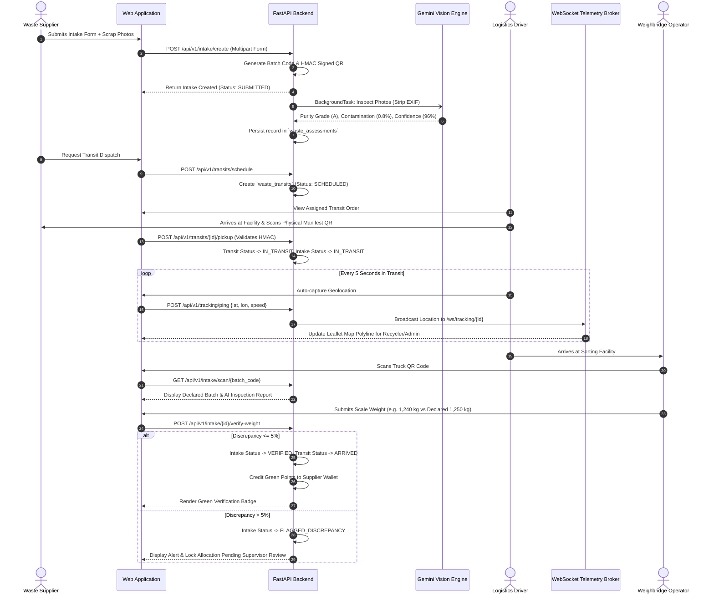
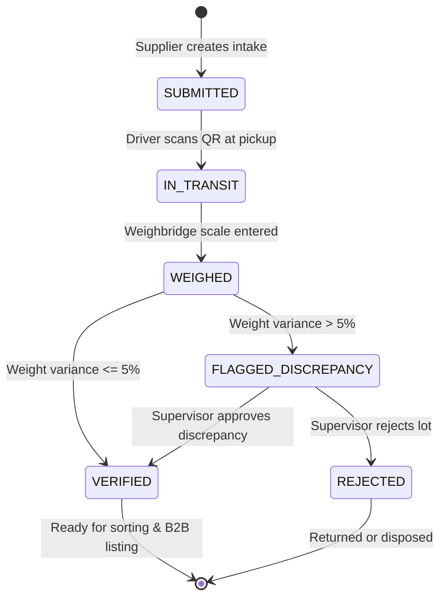
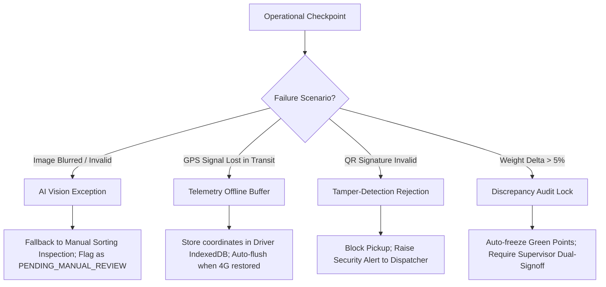

# Web Application Flow Documentation

**Project:** Circular Waste & Resource Marketplace  
**Document Code:** FLOW-DOC-001  
**Sprint Cycle:** Day 3 - GPS Tracking & AI Prototype  
**Lead Solutions Architect:** Solutions Architect & Technical Documentation Writer  
**Status:** Approved for Implementation  

---

## 1. Flow Overview & Domain Context

This document specifies the end-to-end operational flow transforming raw discarded industrial scrap into verified, segregated secondary commodities. Based on **Section 3 (From Collected Waste to Raw Materials)** of the Circular Waste Marketplace Master Plan, it coordinates physical logistics, automated computer vision assessment, tamper-evident manifest verification, and real-time vehicle GPS telemetry.

---

## 2. Flow 1: End-to-End Pickup, AI Quality Verification & Live GPS Transit Flow

### 2.1. Actors Involved

| Actor | Role Key | System Responsibilities |
| :--- | :--- | :--- |
| **Waste Supplier / Generator** | `GENERATOR` | Declares waste batch, uploads scrap photographs, downloads printable QR manifest. |
| **Multimodal AI Vision Engine** | `SYSTEM (AI)` | Performs zero-shot purity grading, contamination detection, and material sub-classification. |
| **Logistics Provider / Driver** | `LOGISTICS` | Scans manifest QR at pickup facility, triggers transit initiation, broadcasts GPS telemetry pings. |
| **Hub / Weighbridge Operator** | `RECYCLER` / `ADMIN` | Receives incoming truck, performs scan-in, inputs physical weighbridge scale readings, audits discrepancies. |

---

### 2.2. Visual Architecture & Journey Flowchart



---

### 2.3. Step-by-Step User Journey

#### Step 1: Intake Creation & Manifest Printing (Supplier)
1. **User Action:** Supplier logs into portal, navigates to `/dashboard/supplier`, and clicks **"+ New Consignment Intake"**.
2. **Form Input:** Selects material category (e.g. `PLASTIC_PET`), enters estimated weight (`1250 kg`), notes storage conditions, and uploads 2 to 5 photographs of the scrap bales.
3. **Backend Execution (`POST /api/v1/intake/create`):**
   * Validates form parameters and confirms supplier profile is active.
   * Generates unique composite human-readable code: `BATCH-20261017-7F3A`.
   * Calculates HMAC-SHA256 signature using `HMAC_SECRET_KEY` over payload `(batch_code, supplier_id, declared_weight_kg)`.
   * Encodes QR code canvas as Base64 data URL.
   * Writes uploaded photos to `static/uploads/` with hashed filenames.
   * Database inserts row into `waste_intakes` with `status = 'SUBMITTED'`.
4. **Output:** Supplier views on-screen manifest card and clicks **"Print QR Manifest Sticker"** to affix to the scrap bales.

#### Step 2: Asynchronous Multimodal AI Quality Assessment (AI Engine)
1. **Trigger:** Immediately upon successful commit of Step 1, FastAPI initiates a background task (`POST /api/v1/ai/inspect/{intake_id}`).
2. **Sanitization:** Images are passed through `Pillow` to strip all device EXIF headers and GPS metadata.
3. **Vision Processing:** Sanitized binary streams are sent to Google Gemini 1.5 Flash Vision API with a strict structured prompt:
   ```json
   {
     "detected_category": "PLASTIC_PET",
     "confidence_score": 0.96,
     "estimated_purity_percentage": 98.2,
     "contamination_detected": false,
     "contamination_details": [],
     "suggested_purity_grade": "GRADE_A"
   }
   ```
4. **Persistence:** Backend writes findings to `waste_assessments`. If contamination $> 15\%$, consignment is flagged for physical secondary review.

#### Step 3: Transit Dispatch & Driver Assignment (Logistics Operator)
1. **User Action:** Dispatcher views incoming consignments in `/logistics/dispatch` and pairs batch with an available transport vehicle.
2. **Backend Execution (`POST /api/v1/transits/schedule`):**
   * Creates record in `waste_transits` with `status = 'SCHEDULED'`, linking `intake_id` and `logistics_provider_id`.
   * Sends real-time notification push to driver mobile view.

#### Step 4: Driver On-Site QR Verification & Departure (Driver)
1. **User Action:** Driver arrives at generator's facility and opens `/driver/transit/{transit_id}`.
2. **Barcode Scan:** Driver scans physical QR code on the waste pallet using mobile camera.
3. **Backend Execution (`POST /api/v1/transits/{id}/pickup`):**
   * Server validates HMAC signature. If invalid or mismatched, request is rejected.
   * Updates `waste_transits.status = 'IN_TRANSIT'` and sets `departed_at = NOW()`.
   * Updates `waste_intakes.status = 'IN_TRANSIT'`.

#### Step 5: Live GPS Telemetry Streaming (Driver to Recycler Map)
1. **Telemetry Pings:** While vehicle is moving, driver's web client captures GPS latitude/longitude every 5 seconds.
2. **Backend Ingestion (`POST /api/v1/tracking/ping`):**
   * Telemetry point is inserted into `vehicle_telemetry` table.
   * Coordinate is published to WebSocket channel `/ws/tracking/{transit_id}`.
3. **Observer View:** Recycler and Admin dashboards display live breadcrumb polyline on Leaflet.js map with dynamic vehicle marker animation.

#### Step 6: Arrival & Weighbridge Verification (Weighbridge Hub Operator)
1. **Arrival Scan:** Truck enters sorting hub weighbridge. Operator scans manifest QR code (`GET /api/v1/intake/scan/{batch_code}`).
2. **Inspection Review:** Screen displays declared batch details alongside AI purity score and photo thumbnail.
3. **Weigh-in Submission:** Operator captures weighbridge scale readout (Gross Truck Weight - Tare Weight = Net Waste Weight) and enters `verified_weight_kg`.
4. **Backend Execution (`POST /api/v1/intake/{id}/verify-weight`):**
   * Calculates $\Delta\text{Weight} = \text{Verified} - \text{Declared}$.
   * Calculates $\% \text{Discrepancy} = (\Delta\text{Weight} / \text{Declared}) \times 100$.
   * Closes transit order: `waste_transits.status = 'ARRIVED'`, `arrived_at = NOW()`.
   * If $| \% \text{Discrepancy} | \le 5.0\%$:
     * Sets `waste_intakes.status = 'VERIFIED'`.
     * Automatically credits Green Reward Points to supplier's `reward_wallets`.
   * If $| \% \text{Discrepancy} | > 5.0\%$:
     * Sets `waste_intakes.status = 'FLAGGED_DISCREPANCY'`.
     * Logs discrepancy warning and creates admin audit ticket.

---

## 3. System States & Entity Lifecycle Matrix

### 3.1. Primary State Transitions (`waste_intakes`)



| Entity | State Name | Trigger Event | Allowed Transitions | Invariant Business Rules |
| :--- | :--- | :--- | :--- | :--- |
| `waste_intakes` | `SUBMITTED` | Generator completes intake form | `IN_TRANSIT` | Must possess valid batch code, HMAC QR, and at least 1 photo. |
| `waste_intakes` | `IN_TRANSIT` | Driver scans QR manifest | `WEIGHED` | Cannot be modified or deleted by supplier once in transit. |
| `waste_intakes` | `WEIGHED` | Scale operator inputs physical weight | `VERIFIED`, `FLAGGED` | Requires authenticated weighbridge operator role. |
| `waste_intakes` | `VERIFIED` | Tolerance confirmed ($\le 5\%$) | None (Terminal) | Green points credited to supplier; available for sorting line. |
| `waste_intakes` | `FLAGGED_DISCREPANCY`| Tolerance exceeded ($> 5\%$) | `VERIFIED`, `REJECTED` | Locked from marketplace listing until administrative resolution. |
| `waste_transits`| `SCHEDULED` | Dispatch assigns vehicle | `IN_TRANSIT`, `CANCELLED`| Driver notified; route origin and destination locked. |
| `waste_transits`| `IN_TRANSIT` | Driver confirms departure | `ARRIVED` | Telemetry GPS broadcast active on WebSocket. |
| `waste_transits`| `ARRIVED` | Drop-off weighbridge reached | None (Terminal) | Telemetry pings cease; total transit travel time calculated. |

---

## 4. Failure Points & Recovery Handling



### 4.1. Failure Point 1: AI Vision Analysis Failure (Blurred Image or Rate Limit)
* **Root Cause:** Supplier uploads blurry photo, inadequate lighting, or cloud vision API times out ($> 5000\text{ms}$).
* **System Handling:**
  * Background task catches `TimeoutException` or unparseable JSON.
  * System does **not** fail the intake creation (supplier workflow remains unblocked).
  * Backend sets `waste_assessments.suggested_purity_grade = 'PENDING_MANUAL_REVIEW'` and `confidence_score = 0.0`.
  * Flags consignment in sorting hub console with an alert badge: *"AI Inspection Inconclusive - Human Visual Grading Required"*.

### 4.2. Failure Point 2: GPS Connection Loss in Remote Transit Corridors
* **Root Cause:** Transport truck travels through cellular dead zones with no 4G/LTE connectivity.
* **System Handling:**
  * Driver's web client detects offline status (`navigator.onLine === false`).
  * Telemetry pings are buffered locally in browser `IndexedDB` with high-resolution device timestamps.
  * Live map observer on recycler dashboard displays: *"Vehicle offline - last known location recorded 4m ago"*.
  * Upon network reconnection, client flushes buffered array via bulk endpoint `POST /api/v1/tracking/batch-sync`, backfilling the route history.

### 4.3. Failure Point 3: Manifest QR Code Tampering or Counterfeit Batch
* **Root Cause:** Unauthorized driver attempts to claim an unassigned batch or scans a forged QR token.
* **System Handling:**
  * Server recalculates HMAC digest using `HMAC_SECRET_KEY` and compares against `qr_code_hash` using constant-time comparison (`hmac.compare_digest`).
  * If signature check fails, server immediately responds with `HTTP 403 Forbidden` (`error_code: "MANIFEST_INTEGRITY_VIOLATION"`).
  * Pickup is blocked, and an automated audit record is written to `audit_logs` alerting the security administrator.

### 4.4. Failure Point 4: Severe Weighbridge Discrepancy ($> 5\%$)
* **Root Cause:** Waste suffered substantial water leakage/evaporation in transit, or supplier deliberately misreported consignment mass.
* **System Handling:**
  * System calculates discrepancy: $| 1250 - 1120 | / 1250 = 10.4\% > 5\%$.
  * State transitions to `FLAGGED_DISCREPANCY`.
  * Green reward points allocation is automatically frozen.
  * An automated reconciliation ticket is generated displaying supplier photos, declared weight, scale weight, and weighbridge calibration certificate.
  * Requires dual-signoff: both Hub Supervisor and Supplier must digitally agree on adjusted invoice weight before lot is released to sorting.
