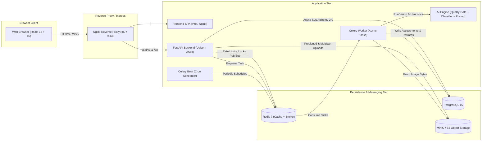
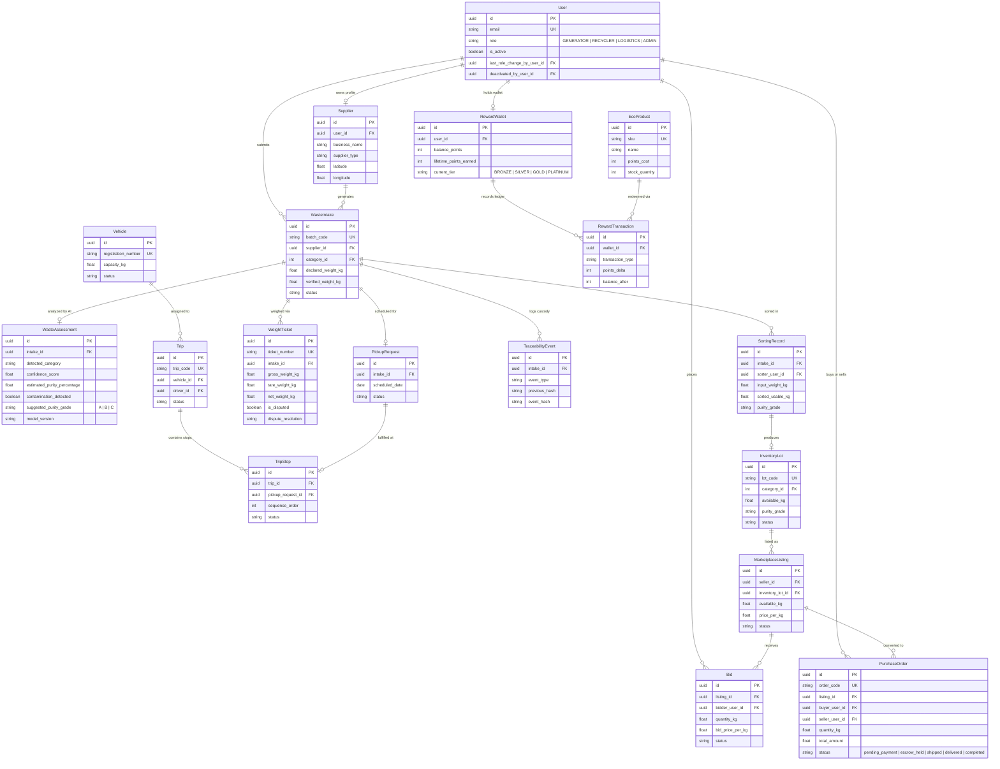
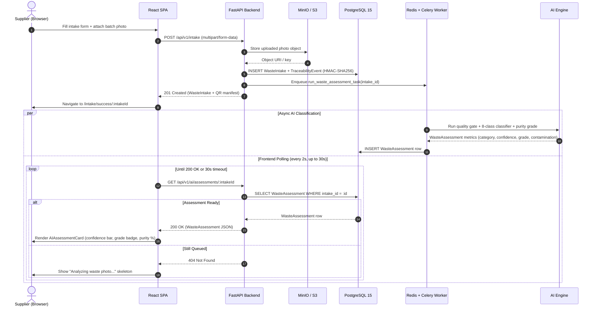

# 🏗️ System Architecture — Circular Waste Marketplace

This document provides the complete technical architecture of the **Circular Waste Marketplace (CWM)** using four canonical Mermaid diagrams:

1. **System Overview (`flowchart LR`)** — Runtime container and service topology
2. **Domain Data Model (`erDiagram`)** — All 18 core SQLAlchemy 2.0 entities and relationships
3. **Waste Submission & AI Assessment (`sequenceDiagram`)** — End-to-end intake, S3 upload, Celery dispatch, and frontend polling
4. **Authentication & Single-Flight Refresh (`sequenceDiagram`)** — Dual-secret JWT issuance, 401 interception, and replay-safe token rotation

---

## 1. System Overview



---

## 2. Domain Data Model (ER Diagram)



---

## 3. Waste Submission & AI Classification Sequence



---

## 4. Authentication & Single-Flight Refresh Sequence

```mermaid
sequenceDiagram
    autonumber
    actor User as User (Browser)
    participant FE as React + Axios Client
    participant Store as Zustand AuthStore
    participant BE as FastAPI Auth Router
    participant DB as PostgreSQL (RefreshToken Table)

    User->>FE: Sign in (Form or 1-Click Demo Account)
    FE->>BE: POST /api/v1/auth/login { email, password }
    BE->>DB: Verify Argon2/Bcrypt hash + insert RefreshToken JTI
    BE-->>FE: 200 OK { access_token (15m), refresh_token (7d) }
    FE->>BE: GET /api/v1/auth/me (Bearer access_token)
    BE-->>FE: 200 OK (User profile + role)
    FE->>Store: setAuth(user, tokens)

    Note over FE,BE: Access token expires after 15 minutes; 3 concurrent API calls fire

    par Concurrent API Calls
        FE->>BE: GET /api/v1/dashboards/supplier
        BE-->>FE: 401 Unauthorized
    and
        FE->>BE: GET /api/v1/rewards/wallet
        BE-->>FE: 401 Unauthorized
    end

    Note over FE: Axios interceptor acquires single-flight refreshPromise mutex

    FE->>BE: POST /api/v1/auth/refresh { refresh_token }
    BE->>DB: Verify JTI not revoked -> revoke old JTI -> mint new token pair
    BE-->>FE: 200 OK { new access_token, new refresh_token }
    FE->>Store: Persist rotated token pair

    par Replay Queued Requests with New Access Token
        FE->>BE: GET /api/v1/dashboards/supplier (New Bearer token)
        BE-->>FE: 200 OK
    and
        FE->>BE: GET /api/v1/rewards/wallet (New Bearer token)
        BE-->>FE: 200 OK
    end
```
